---
format:
  pdf:
    documentclass: article
    keep-tex: true
    lof: false
    toc: false
    number-sections: false
    mainfont: "Nimbus Sans"
  docx: default
  gfm: default
bibliography: references.bib
csl: asm.csl
geometry: margin=1.0in
fontsize: 11pt
linestretch: 1.75
header-includes:
 - \usepackage[left]{lineno}
 - \linenumbers
 - \modulolinenumbers
 - \usepackage{helvet}
 - \renewcommand*\familydefault{\sfdefault}
 - \usepackage[T1]{fontenc}
execute:
  echo: FALSE
  tidy: TRUE
  eval: TRUE
  warning: FALSE
  message: FALSE
  cache: FALSE
---

\raggedright

```{r}
options(tidyverse.quiet = TRUE)
suppressPackageStartupMessages(library(tidyverse))
suppressPackageStartupMessages(library(glue))
suppressPackageStartupMessages(library(data.table))
suppressPackageStartupMessages(library(here))

inline_hook <- function(x){

  if(is.list(x)){
    x <- unlist(x)
  }
  if(is.double(x)){
    paste(format(x, big.mark=',',
                  digits = 2, nsmall = 2, scientific=FALSE))
  } else if(is.integer(x)){
      paste(format(x, big.mark=',',))
  } else {
      paste(x)
  }
}
knitr::knit_hooks$set(inline=inline_hook)

package_version <- function(package){

  paste(unlist(packageVersion(package)), collapse='.')

}


oxford_comma <- function(x) {

  x <- map_chr(x, inline_hook)

  if(length(x) < 2){
    x
  } else if(length(x) == 2){
    paste(x, collapse = " and ")
  } else {
    paste(paste(x[-length(x)], collapse=", "), x[length(x)], sep=", and ")
  }
}
```

# Lorem ipsum

\vspace{20mm}

**Running title:** Hipster ipsum is better

\vspace{20mm}

Patrick D. Schloss ^\textdagger^

\vspace{40mm}

 \textdagger To whom correspondence should be addressed:


\href{mailto:pschloss@umich.edu}{pschloss@umich.edu}

Department of Microbiology & Immunology

University of Michigan

Ann Arbor, MI 48109

\vspace{20mm}

**Research article**



```{r datasets}
permanova <- fread(here("data/pooled_data/permanova_treatment.tsv"))
knn <- fread(here("data/pooled_data/knn_results.tsv.gz"))
ns <- fread(here("data/pooled_data/case_study_ns.tsv"))

processes <- c("raw", "optspace", "gemelli_2", "zclr", "nclr", "oclr", "deseq2",
               "css", "srs", "bray_pcoa")
```

## Abstract


Sus umami skateboard activated charcoal XOXO cornhole, thundercats pitchfork. Succulents street art semiotics, artisan lo-fi same food truck forage aesthetic plaid drinking vinegar ugh slow-carb. Sustainable vexillologist ramps cold-pressed, selfies pop-up microdosing messenger bag slow-carb. Lo-fi fingerstache cred, copper mug chicharrones DSA chambray. Craft beer meditation shabby chic, put a bird on it tonx ramps tumeric palo santo etsy dreamcatcher chartreuse snackwave. Fashion axe kogi sus, migas etsy gluten-free semiotics hammock chartreuse cardigan.


## Importance

Taiyaki hoodie letterpress, franzen man braid bushwick food truck humblebrag chia palo santo vinyl keffiyeh. IPhone ugh kitsch tousled tumblr messenger bag, kogi actually taiyaki. Austin taiyaki succulents vaporware letterpress bruh. Wayfarers listicle lyft beard tousled keffiyeh fingerstache neutral milk hotel ramps prism. Tote bag vape gentrify, fingerstache fixie marxism enamel pin pork belly cardigan microdosing hoodie. Freegan Brooklyn biodiesel, fanny pack actually kombucha organic whatever literally crucifix. Fingerstache kombucha subway tile squid, marxism kogi VHS ethical distillery fanny pack jean shorts.




## Introduction

[@Schloss2024a; @Schloss2024b]

A persistent challenge in amplicon and shotgun metagenomic sequencing of microbial communities is the variation in the number of reads obtained across samples [**XXXXX**]. The variation in the number of reads generally occurs because of an accumulation of sampling errors during library generation that includes attempts to pool equimolar amounts of DNA for subsequent sequencing. It is not uncommon to observe as much as 100-fold variation in sequencing depth [**XXXXX**]. This challenge is not unique to microbial ecologists and has long plagued landscape and animal ecologists [**XXXXX**]. The classical approach to control for uneven sampling has been rarefaction [**XXXXX**]. In rarefaction, a consistent number of individuals are randomly sampled from each sample. An alpha or beta diversity metric is then calculated from the sampling. The random subsampling and diversity measurement steps are repeated a large number of times (e.g., 100 or 1,000) and the measurements are averaged over the subsamples [**XXXXX**]. Unfortunately, the term "rarefying" and occasionally rarefaction have been misidentified as a single subsampling step [**XXXXX**]. Regardless, over the past 10 years, the process of rarefaction has become controversial because some view the choice of the sampling depth as arbitrary, the metrics can become more similar than they truly are, and because the practice of downsampling to a common number of sequences leaves the impression that good data are being unnecessarily discarded [**XXXXX**]. Numerous alternatives have been proposed including calculating the relative abundance of each taxon in a community so that they sum to 1 within a sample [**XXXXX**], normalization of counts so that the total number of individuals sums to a user defined value [**XXXXX**], use of estimators of diversity that can extrapolate beyond the number of observed individuals [**XXXXX**], and the use of compositional statistics, which are based on a log ratio of taxon counts to a reference value [**XXXXX**].

Researchers have adopted compositional methods because the number of sequences obtained per sample is typically independent of the true number of individuals in a community and so the number of times each taxon is observed is not independent of the other taxa [**XXXXX**]. The general approach is to calculate a centralized log ratio (i.e., CLR) where the abundance of each taxon within a sample is divided by the geometric mean abundance within the sample, which is then used as the argument for the natural logarithm. These values are then used to calculate pairwise euclidean distances between samples resulting in so-called Aitchison distances [**XXXXX**]. Aside from controlling for the compositional nature of sequence data, proponents of the Aitchison distance claim that the distances are insensitive to differences in sampling effort [**XXXXX**]. A challenge of Aitchison distances is that because microbial communities are patchy a large number of features will have a frequency of zero in each sample. This will cause the geometric mean to be undefined. To overcome this challenge, factors are added to the data. Three approaches have been proposed: adding a pseudocount of 1 all frequency data (i.e., Nudge CLR), adding a pseudocount of 1 divided by the total number of individuals in the sample (i.e., Nudge CLR), and imputing zero values to be a random small value (i.e. Zero CLR) [**XXXXX**]. As an alternative to these transformations, Martino et al. [**XXXXX**] (i.e., Martino) proposed calculating CLR values for each sample after ignoring zero values followed by matrix completion or robust principal components analysis (i.e., RPCA). The authors claimed that the advantage of RPCA over the other CLR-based approaches was that it did not require imputing zero values and that the method was less sensitive to uneven sampling effort.

In contrast to these claims, I have shown that the output of RPCA and other alternatives to rarefaction are more sensitive to uneven sampling than rarefaction [**XXXXX**]. Furthermore, use of these methods can inflate the false detection rate and decrease the statistical power to detect differences in alpha and beta diversity metrics. Given the near unanimous agreement over the past decade that rarefaction is "inadmissible" and the development of alternatives to rarefaction, one might question why my results disagree so markedly with those of others. There are several possible reasons. First, researchers often propose new methods by demonstrating their method reveals new insights over old methods without objectively benchmarking the method [**XXXXX**]. Because one cannot know the true difference between samples, a positive or negative result with experimental data cannot be interpreted. Second, when benchmarking tests are developed, researchers may inadvertently select tests that favor the method they are developing. This was the case in my recent re-analysis of the original paper that called rarefaction into question [**XXXXX**]. Therefore, it is necessary to use a comprehensive benchmarking test suite that allows one to compare diverse methods using inference methods that are commonly used by researchers. Third, the choice of how to simulate community data can inadvertently favor the method being developed. A popular cliché states that "all models are wrong, some are useful" [**XXXXX**]. Similar to one's choice of benchmarking tests, the modelling approach may favor some methods over others. For instance, I have critiqued how others have accounted for variation in sampling depth as being unlike what we see in experimental data [**XXXXX**].

In my previous analyses advocating for rarefaction, I generated null community models and treatment groups with known effect sizes by creating taxon abundance distributions and sampling depths based on 12 published datasets [**XXXXX**]. Alternatively, Martino modelled communities with known effect sizes using a statistical model that sought to mimic the diversity of communities described in a study comparing the microbial communities found on people's fingertips and their computer keyboards [**XXXXX**]. As described in Martino, the overall simulation framework involved simulating two treatment groups each represented by 100 communities for a total of 200 communities. Each community contained as many as 1,000 taxa, which they referred to as features. For each treatment group they fit a normal distribution to the relative abundances of taxa from two individuals' samples to obtain a mean and standard deviation for each taxon. The fraction of taxa that overlapped between treatment groups was also selected to mimic the overlap observed between the two individuals. The expected taxon relative abundances for each sample were the same across each sample within the same treatment group. Next, a common normal distribution with a single mean and standard deviation was used to generate noise (i.e., homoscedastic noise) that added to each relative abundance value to add variation across samples and features. Next, a random subset of sample-taxa combinations were selected for incorporation of additional noise (i.e., heteroscedastic noise). Finally, the sample-taxa combinations were randomly sampled using a Poisson-lognormal distribution to generate the simulated number of sequences for each sample-taxa combination so that the total number of sequences within a sample contained approximately 1,000, 2,000, 4,000, or 10,000 sequences per simulation. One set of 200 samples were simulated for each sequencing depth. In addition to the simulation where a subset of taxa was shared in both treatment groups, Martino created positive and negative control simulations. In the positive control simulation, there were no overlapping taxa resulting in two clearly defined groups of samples. In the negative control simulation all the taxa were shared in similar abundance so that the groups of samples could not be distinguished. Finally, they compared RPCA to other methods using two published datasets.

This difference in modelling strategy has created an interesting opportunity to reframe whether to use rarefaction and to reassess the performance of RPCA and other CLR-based approaches. Although Martino used an interesting modelling approach, they did not compare RPCA to other CLR-based approaches or to rarefaction. Furthermore, they used benchmarking tests that did not reflect how researchers typically analyze microbial community data. Therefore, the goal of the current study was to benchmark RPCA and other CLR-based methods relative to rarefaction using the modelling framework used by Martino.


## Results

### Description of simulated communities

Martino made a git-based repository available on GitHub that includes the actual benchmarking code written in Python and the data used in their analysis (https://github.com/cameronmartino/deicode-benchmarking); the code and data from that repository are included as the directory "deicode_benchmarking" within repository for the current analysis (https://github.com/SchlossLab/Schloss_RPCA_mSystems_2025). To maintain a connection to the original simulations and implement a broader set of tests, several changes were necessary in the implementation of Martino's code. First, because one goal of this study was to assess the effect of variation in sequencing effort on the performance of RPCA, I modified the parameters inputted to Martino's code to produce more than the desired number of sequences per sample and then performed a single subsampling of the samples to 1,000, 2,000, 4,000, or 10,000 sequences per sample to have exactly the desired number of sequences per sample. Second, to account for the effect of the random number generator, instead of replicating each simulation condition only once as Martino did, I replicated each condition 10 or 100 times depending on the analysis. Third, Martino only analyzed their positive and negative control simulations with 4,000 sequences. My implementation of their simulations and subsequent tests added the sequencing depths of 1,000, 2,000, and 10,000 sequences for the positive and negative controls and for the simulations with partially overlapping treatment groups. The regenerated heatmaps and principal coordinates analysis (PCoA) plots in **Figure 1** are qualitatively similar to those in Figure 3 of Martino. The most notable difference with Martino is that they inadvertently switched the labels of the axes and performed the OCLR transformation on features rather than samples (**Supplementary Text**). Replicating what Martino reported, the first two axes of the Bray-Curtis ordinations only explain a fraction of the total variation in the data while the RPCA ordinations explained all the variation. This was because RPCA is run by giving the algorithm a desired number of axes; in this case, 2 axes. The ratio of the fraction of the variation explained by the first two axes were similar between RPCA and PCoA with Bray-Curtis.


```{r}
non_perfect <- permanova %>%
  filter(dataset == "overlap" & process %in% processes) %>%
  group_by(depth, process, distance) %>%
  summarize(p = mean(p_value < 0.05), n = n(), .groups = "drop") %>%
  filter(p != 1)

stopifnot(all(non_perfect$process == "optspace"))
stopifnot(nrow(non_perfect) == 4)

```

### Comparison of simulated communities using PERMANOVA

Martino used the PERMANOVA F-statistic to compare the ability of RPCA to differentiate treatment groups when using raw counts and when removing zero values prior to calculating the CLR (RCLR). Using the partially overlapping treatment groups they found that the RCLR pretreatment yielded larger F-statistics than using raw counts. Repeating Martino's PERMANOVA analysis, I replicated their results when using RPCA (**Figure 2**). However, by generating 10 replicate datasets (Martino only performed one), I was observed considerable variation across replicates for the F-statistics calculated using RPCA with raw counts. Unfortunately, Martino did not make any comparisons to other methods of calculating distances. Calculating Euclidean distance using other central log ratio and DeSeq2 transformations and Bray-Curtis distances using raw counts and CSS and SRS normalized data all resulted in small F-statistics. I suspected that the RPCA data generated relatively large F-statistics because the Euclidean distances calculated using RPCA was only done with the first two axes. This would have removed a considerable amount of variation that was embedded in the third and higher axes. The result would be elevated F-statistics. To test this hypothesis, I performed PCoA on Bray-Curtis distances, calculated Euclidean distances using the first two axes of the resulting PCoA, and subjected those distances to PERMANOVA (see "Bray-Curtis PCoA" data in the Euclidean distance section of **Figure 2**). The calculated F-statistics were even larger than those generated by RPCA. This suggested that RPCA may make communities appear more similar than they are when differences are more pronounced in higher axes. Regardless of the relative scale of the F-statistics, the replicates for all approaches yielded significant P-values except for those generated using RPCA with raw counts.

```{r}
knn_summary <- knn %>%
  filter(dataset %in% c("positive", "negative", "overlap") & process %in% processes) %>%
  group_by(dataset, depth, knn_approach, process, distance, rep) %>%
  summarize(m = median(test), k = median(k_size), .groups = "drop") %>%
  group_by(dataset, depth, knn_approach, process, distance) %>%
  summarize(m = median(m), k = median(k), .groups = "drop")

neg_summary <- knn_summary %>%
  filter(dataset == "negative" & knn_approach == "knn_cmfixed") %>%
  group_by(dataset, depth, process, distance) %>%
  summarize(mean = mean(m), min = min(m), max = max(m), .groups = "drop") %>%
  summarize(mean_mean = mean(mean), sd_mean = sd(mean))

pos_summary <- knn_summary %>%
  filter(dataset == "positive" & knn_approach == "knn_cmfixed") %>%
  group_by(dataset, depth, process, distance) %>%
  summarize(mean = mean(m), min = min(m), max = max(m), .groups = "drop") %>%
  summarize(mean_mean = mean(mean), sd_mean = sd(mean))

k_values <- knn_summary %>%
  filter(dataset == "overlap") %>%
  group_by(knn_approach) %>%
  summarize(med_k = median(k) %>% as.integer(),
            lquart = quantile(k, prob = 0.25) %>% as.integer(),
            uquart = quantile(k, prob  = 0.75) %>% as.integer())
  
knn_cmgrid <- filter(k_values, knn_approach == "knn_cmgrid")
knn_pdsgrid <- filter(k_values, knn_approach == "knn_pdsgrid")
```

### Comparison of simulated communities using KNN Classification

In addition to comparing F-statistics from PERMANOVA, Martino used KNN classification to distinguish between the two partially overlapping treatment groups. Although Martino's text indicated they used 40% of the samples in the training set and 60% in the testing set (i.e., a 40:60 cross validation split), their code indicates it was actually the opposite with 60% of the samples in the training set and the remaining in the testing set (**Supplemental Text**). To execute the KNN classification, Martino used the first two axes calculated from RPCA using raw counts and RCLR transformed data as the input to their KNN classification. Because I was interested in comparing other transformations and the use of Bray-Curtis distances, I wrote a KNN classification procedure that would allow me to input distance matrices. Furthermore, I replicated the 60-40 split 100 times for each of the 10 simulations reporting the median accuracy on the 40% testing data for each simulation. The original Martino data indicated that the accuracy of using raw counts with RPCA was near 0.5, indicating it did no better than randomly guessing. While the minimum values I observed across the 10 replicate simulations overlapped with these results, the median values were all better than random ("Raw + RPCA" in **Figure 2**). I replicated Martino's result showing that using RCLR transformed counts as input to RPCA yielded higher accuracy than using raw counts.

Next I sought to place the RPCA results in context with other methods. I generated Euclidean distance matrices using other central log ratio methods and DeSeq2. I also generated Bray-Curtis distance matrices using the raw counts and CSS and SRS Normalization. These methods all yielded similar results, likely because all of samples in the simulations had the same sequencing depth. Compared to these other approaches, RPCA was more sensitive to differences in sequencing depth. Although accuracy values across all methods were comparable at 4,000 and 10,000 sequences, the RPCA-based methods underperformed the others at 1,000 and 2,000 sequences.

Martino did not report the classification accuracy for their positive and negative controls. As would be expected, the mean accuracy for classifying the treatment groups in the negative control model across each depth, transformation, and distance calculation was `r neg_summary$mean_mean` (sd = `r format(round(neg_summary$sd_mean, 2), 2)`). Furthermore, the mean accuracy for classifying samples in the positive control was `r pos_summary$mean_mean` (sd = `r format(round(pos_summary$sd_mean, 2), 2)`).

Rather than using a training data set to identify an optimal number of neighbors (i.e., K), Martino used 13 neighbors. To assess whether the classification was sensitive to the number of neighbors, I split the 60% of samples in the training data into another 60-40 split to train and optimize the number of neighbors 1,000 times [**XXXXX**]. Across the various conditions, the median optimal number of neighbors was `r format(round(knn_cmgrid$med_k))` (IQR=`r format(round(knn_cmgrid$lquart))` to `r format(round(knn_cmgrid$uquart))`). When I instead performed 1,000 80-20 splits on the full and training datasets, the median optimal number of neighbors was `r format(round(knn_pdsgrid$med_k))` (IQR=`r format(round(knn_pdsgrid$lquart))` to `r format(round(knn_pdsgrid$uquart))`). Regardless of finding that the optimal number of neighbors was consistently larger than the 13 that Martino used, the difference in accuracy values was only modestly better than the other fitting procedures when using 80-20 splits (**Figure S1**).


### Comparing PERMANOVA and KNN Classification results with more similar treatment groups

Using the simulation where the treatment groups partially overlapped, the PERMANOVA analyses yielded significant P-values and KNN classification were effective at distinguishing between the groups for nearly all of the methods. Because the simulated effect size was so large, it was not possible to easily differentiate between the methods' performance. Therefore, I created treatment groups that were more similar than those simulated by Martino. Unfortunately, in the process of modifying their code, I identified a number of incongruities between Martino's written description and their code. This limited my ability to reuse their code to simulate greater overlap between the treatment groups (**Supplemental Text**). These issues included: (i) samples rather than features were shared between treatment groups; (ii) among samples from the same treatment group, the relative abundance distributions for the features were uniform; (iii) the total number of individuals in the samples varied across the simulated datasets; (iv) the heteroscedastic source of noise was actually applied to all sample-feature combinations; (v) negative mean values were used when sampling normal distribution sampling functions when calculating the heteroscedastic noise; (vi) negative abundance values generated after applying the heteroscedastic noise were made positive; and (vii) setting the random number generator seed was unable to produce reproducible simulations. I rewrote the simulation code in the R programming language to correct these issues. To simulate a more nuanced difference in treatment groups, I increased the total number of features across all samples from 1,000 to 10,000 and set 12 features to be differentially abundant between the treatment groups; these values were selected to create conditions where approximately 50% of PERMANOVA tests using Bray-Curtis distances yielded P-values less than 0.05. Using the same number of features, I recreated negative and positive control simulations in which all features were shared or where the features were differentially represented between one of the two treatment groups. The resulting simulations provided more realistic benchmarking data than which was observed by Martino (**Figure 3**). The simulations were replicated 100 times to obtain greater precision in calculating the power to detect differences by PERMANOVA and the accuracy of KNN classification.

Using the revised simulation data revealed a considerable difference in the performance of PERMANOVA and KNN classification relative to the original simulation. Among the various methods, the RPCA-based methods performed the worst by both PERMANOVA and KNN classification (**Figure 4**). There was effectively no statistical power to detect differences using RPCA or to classify samples using KNN classification even at the largest sequencing depths. It was not possible to distinguish the performance between the various CLR and DeSeq2 methods using Euclidean distances or any of the methods when Bray-Curtis distances were calculated. Among these methods, the power to detect differences was routinely above 0.75 when 10,000 sequences were generated per sample. For these methods, there was a clear relationship between the number of sequences obtained from each sample and the observed power and accuracy. Similar to the earlier comparison of approaches for fitting the number of neighbors, the performance of KNN classification was modestly better using 80-20 splits with a grid-based search (**Figure S2**). From the revised simulations, it is evident that the performance of RCLR and RPCA was considerably worse than the other methods.

```{r}
ds_treat_n <- count(ns, dataset, treatment)

sponge_n <- filter(ds_treat_n, dataset == "sponges") %>%
    pivot_wider(names_from = treatment, values_from = n)
sa_n <- filter(ds_treat_n, dataset == "sleep_apnea") %>%
    pivot_wider(names_from = treatment, values_from = n)
crc_n <- filter(ds_treat_n, dataset == "crc") %>%
    pivot_wider(names_from = treatment, values_from = n)

```

### Description of case study datasets and analysis

After describing the results of their simulations, Martino and colleagues used two published datasets as case studies to evaluate RPCA and related methods. They evaluated RPCA relative to Bray-Curtis and weighted UniFrac distances using PERMANOVA, KNN, and ordinations. The two datasets were drawn from a natural study comparing healthy and stressed sponges [**XXXXX**] and from a study that used a murine model of sleep apnea where mice were given air or intermittent hypoxia and hypercapnia (IHH) [**XXXXX**]. Both datasets were small relative to other papers published at the time. The sponge dataset had `r sponge_n$healthy` healthy and `r sponge_n$stressed` stressed samples and the sleep apnea dataset had `r sa_n$air` air treated and `r sa_n$ihh` IHH treated samples (**Figure 5**). Also, the effect sizes in both studies were relatively large and could easily be differentiated by the first two PCoA axes. Similar to the results from the simulations, I wondered whether differences between the methods would be observed when there was a smaller effect size. Therefore, I added a third dataset from a study that explored associations between the microbiome and colorectal cancer [**XXXXX**]. The differences between healthy individuals and those with screen relevant colonic neoplasias were not obvious by PCoA and the study included more subjects. The colorectal cancer dataset included `r crc_n$healthy` subjects with healthy colons and `r crc_n$srn` subjects with screen relevant colonic neoplasias (**Figure 5**). The three datasets were analyzed in parallel.

After conducting an exhaustive review of the code that Martino and colleagues provided in their GitHub repository, I discovered several problems in the original analysis of the case studies. The details of this review can be found in the **Supplementary Text**. Aside from the selection of datasets with large effect sizes that were visible using the first two PCoA axes, the principle problems included (i) performing a single subsampling the samples in each data to an artificially low number of sequences (i.e., 1,000) for the Bray-Curtis and weighted UniFrac distance calculations; (ii) when generating balanced designs of the data sets, they performed 9 rather than the 10 random subsamples of the datasets as was described in the manuscript; (iii) running RPCA with a rank of 3 for the Sleep Apnea dataset rather than 2 as was described in the manuscript; (iv) significant problems in the training and testing of the KNN classification to the data including the selection of the hyperparameter, lack of balance design in the stratifications, and only performing a single iteration; and (v) not using the actual Bray-Curtis and weighted UniFrac distances or more PCoA axes in the KNN classification. The following analyses used the remedies as described in the **Supplementary Text**. 

Similar to the analysis of the simulated datasets, pairwise Euclidean distances were calculated based on using 2 or 3 RPCA axes, Nudge, One, and Zero CLR transformed data, OptSpace and DeSeq2 transformed data, raw counts, relative abundance data, a single subsampling, with rarefaction, and based on the first two PCoA axes using Bray-Curtis distances. Pairwise Bray-Curtis distances were calculated using raw counts, relative abundance data, SRS and CSS normalized data, a single subsampling, and with rarefaction. My analysis did not include the weighted UniFrac distances since reliable trees are difficult to generate for large datasets and because previous experience has demonstrated that results of Bray-Curtis and weighted UniFrac distances rarely disagree.

```{r}
n_cs <- permanova %>%
  filter(
    dataset %in% c("sponges", "sleep_apnea", "crc") & depth != 1000 &
      nsamples_per_group != "all" & process == "raw" &
      distance == "bray" & rep == 1 ) %>%
  slice_max(as.numeric(nsamples_per_group), by = dataset) %>%
  select(dataset, nseqs = depth, nsamples = nsamples_per_group)

nseqs_cs <- n_cs %>%
  select(dataset, nseqs) %>%
  mutate(nseqs = format(nseqs, big.mark = ",")) %>%
  pivot_wider(names_from = dataset, values_from = nseqs)

nsamples_cs <- n_cs %>%
  select(dataset, nsamples) %>%
  pivot_wider(names_from = dataset, values_from = nsamples)


non_sig_permanova <- permanova %>%
  filter(
    dataset %in% c("sleep_apnea", "sponges", "crc") &
    process != "gemelli_auto" & nsamples_per_group == "all" & 
    depth == 1000
    ) %>%
  filter(p_value > 0.05)

stopifnot(nrow(non_sig_permanova) == 2)
stopifnot(non_sig_permanova$process == c("gemelli_2", "gemelli_3"))

crc_g2 <- filter(non_sig_permanova, process == "gemelli_2") %>% mutate(p_value = format(round(p_value, 2), nsmall = 2L)) %>% pull(p_value)

crc_g3 <- filter(non_sig_permanova, process == "gemelli_3") %>% mutate(p_value = format(round(p_value, 2), nsmall = 2L)) %>% pull(p_value)

```

### PERMANOVA analysis of case study datasets

I repeated Martino's PERMANOVA analysis to test whether the average beta-diversity was significantly different between the two treatment groups within each of the three case studies. Their analysis varied the number of samples per treatment group to maintain a balanced design. This choice was odd since PERMANOVA is not sensitive to unbalanced sampling. When I used all of the samples available and performed the PERMANOVA analysis, the only dataset and methods that did not yield a significant result was for the CRC dataset using RPCA with 2 or 3 axes (P = `r crc_g2` and `r crc_g3`, respectively). A second odd choice was to subsample the number of sequences to 1,000 sequences per sample when calculating Bray-Curtis distances and use all of the sequences with RPCA. They could have increased the number of sequences by more than ten-fold without adversely impacting the number of samples in their analysis (**Figure 5**). Acceptable thresholds could have been `{r} nseqs_cs$sleep_apnea` sequences for the sleep apnea dataset, `{r} nseqs_cs$sponges` sequences for the sponge dataset, and `{r} nseqs_cs$crc` sequences for the CRC dataset. Overall, using the higher sequence count thresholds did not drastically alter the results of the analyses; however, it typically resulted in larger PERMANOVA F statistics (**Figure 6**). For the remainder of the PERMANOVA analysis, I have used the larger number of sequences instead of 1,000 sequences.

The results of my reanalysis of the sponge and sleep apnea datasets using PERMANOVA replicated what was observed in the original study (**Figure 7**). Across the various transformations and sample sizes, at least 9 of the 10 replicates yielded significant differences between the treatment groups. For the colorectal cancer dataset the results were more varied. The most striking result was that RPCA with 2 or 3 axes only yielded significant results in 2 or 3 of the 10 replicates. When 5 or 9 axes were used, the tests were more frequently significant. With the exception of Zero CLR and using distances extracted from Bray-Curtis PCoA, the other transformations consistently yielded significant results. Across all methods, the fraction of significant tests increased with the number of samples in each group. The inclusion of the colorectal cancer dataset, which had a smaller effect size than the sponge and sleep apnea datasets helped to highlight the shortcomings of RPCA.


### KNN classification of case study datasets

I repeated Martino's KNN-based analysis using the remedies described in the **Supplementary Text** on all three datasets with each of the methods for correcting for uneven sampling effort (**Figure 8**). Rather than using their strategy of using a fixed number of nearest neighbors, I repeatedly fit the hyperparameter using cross validation training and testing datasets. Overall, using the higher sequence count threshold did not dramatically alter the results of the analyses; however, it typically resulted in higher accuracy to classify samples into the treatment groups for the sleep apnea dataset, which had fewer samples (**Figure 6**). For the remainder of this analysis, I will describe the results using the larger number of sequence.

```{r}
knn_cs_summary <- knn %>%
  filter(
    dataset %in% c("sponges", "sleep_apnea", "crc") &
    process != "gemelli_auto" & 
    knn_approach == "knn_pdsgrid" &
    depth != 1000) %>%
    select(-depth, -knn_approach) %>%
  summarize(rep_test = median(test),
            .by = c(dataset, nsamples_per_group, rep, process, distance)) %>%
  summarize(test = median(rep_test),
            .by = c(dataset, nsamples_per_group, process, distance))
  
sponges <- knn_cs_summary %>%
  filter(dataset == "sponges" & nsamples_per_group == 78) %>%
  arrange(test) %>%
  mutate(test = format(round(test, 2), nsmall = 2))

eighty_eight <- filter(sponges, process == "optspace") %>% pull(test) 
ninety_four <- filter(sponges, process == "gemelli_2") %>% pull(test)
one_hundred <- filter(sponges, process == "rare" & distance == "euclidean") %>% pull(test)
```

Similar to the PERMANOVA analysis, my KNN classification results largely replicated those observed for the sleep apnea and sponge datasets. In general, using RPCA with any number of axes resulted in median accuracies greater than 0.90 for these datasets. When using RPCA with the colorectal cancer dataset the accuracy increased modestly with the number of axes and the effect of the number of samples per group did not have a consistent effect on classification accuracy. Caution should be used in interpreting such results as there is no *a priori* reason to use more than 2 axes. Within the sponge dataset there was little variation in the classification accuracy with most methods yielding values between `r ninety_four` and `r one_hundred`; the worst performer was using raw abundances as input to RPCA with two axes (accuracy = `r eighty_eight`). Within the sleep apnea dataset the CLR-based methods and DeSeq2 transformed data outperformed the RPCA methods, which outperformed the other Euclidean-distance methods; accuracies calculated using KNN with Bray-Curtis distances performed similar to the RPCA-based methods. Finally, within the colorectal cancer dataset, KNN classification using Bray-Curtis distances outperformed the Euclidean-based distances for all transformations except when RPCA was used with 5 or 9 axes. These results again demonstrate that RPCA-based methods performed worse than other methods when the effect size was small. Even for the sponge and sleep apnea datasets the differences in accuracy were negligible relative to other methods.


### Sampling depth experiment with simulated and experimental data

To test the sensitivity of various methods to uneven sequencing effort Martino generated duplicated each of the case study samples by subsampling one copy to 500 sequences per sample and subsampling the other copy to 100 sequences per sample. They calculated distances using Jaccard, Bray-Curtis, and RPCA and then visualized the distances using ordination. Martino stated that "RPCA alleviated the clustering by sequencing depth both qualitatively and quantitatively". However, in the original analysis presented in their supplementary materials, the ordinations still showed clustering by sampling depth for RPCA. Furthermore, the Jaccard and Bray-Curtis distances were not calculated using rarefaction, which is the typical strategy to control for such uneven sampling with these metrics. To reassess the sensitivity of RPCA and other methods to uneven sequencing effort, I repeated their analysis with the simulated datasets generated using the original and revised code and the case study datasets. Instead of using 100 and 500 sequences per sample, I used 5,000 and 10,000 sequences per sample. A two factor PERMANOVA design (i.e., depth and treatment group) was used to test for significant differences in the level of sequencing effort. The results of this analysis were consistent with other analyses in this and other studies (**Figure 9**). Raw counts, relative abundances, RPCA-based distances, CLR-transformed counts, DeSeq2, and CSS normalized data yielded significant differences between the number of sequences per sample. They were not able to control for uneven sampling effort. In contrast, SRA normalization, subsampling, and rarefaction consistently controlled for the effects of uneven sampling effort across the simulations.


## Discussion

A frequent challenge in benchmarking data analysis methods is that investigators often obtain different results for the same method. 

* Overall method problems`
  * Choice of number of partitions/axes seems arbitrary/no guidance. Controls and sponges used 2, sleep apnea used 3. Default is 3
  * Authors acknowledged that RPCA doesn't work on time series datasets
* Benchmarking should use methods that are commonly used in the field. KNN was interesting, but not relevant. Who is using raw with matrix completion?
* Statistical modeling approach is appealing for building communities and treatment groups and nicely complements results found using simulations based on observed sequencing counts and sequencing depths
* Comment on problematic coding practices
* Use rarefaction

## Materials & Methods

* Deicode benchmarking data and code

* KNN analysis

* Description of Sampling depth experiment
  * adonis2 model

* Workflow
  * Snakemake
  * Conda - Software versions
  * GitHub

## Acknowledgements

* Thanks for making code publicly accessible!
* Funding agencies




## References {.unnumbered}

::: {#refs}
:::



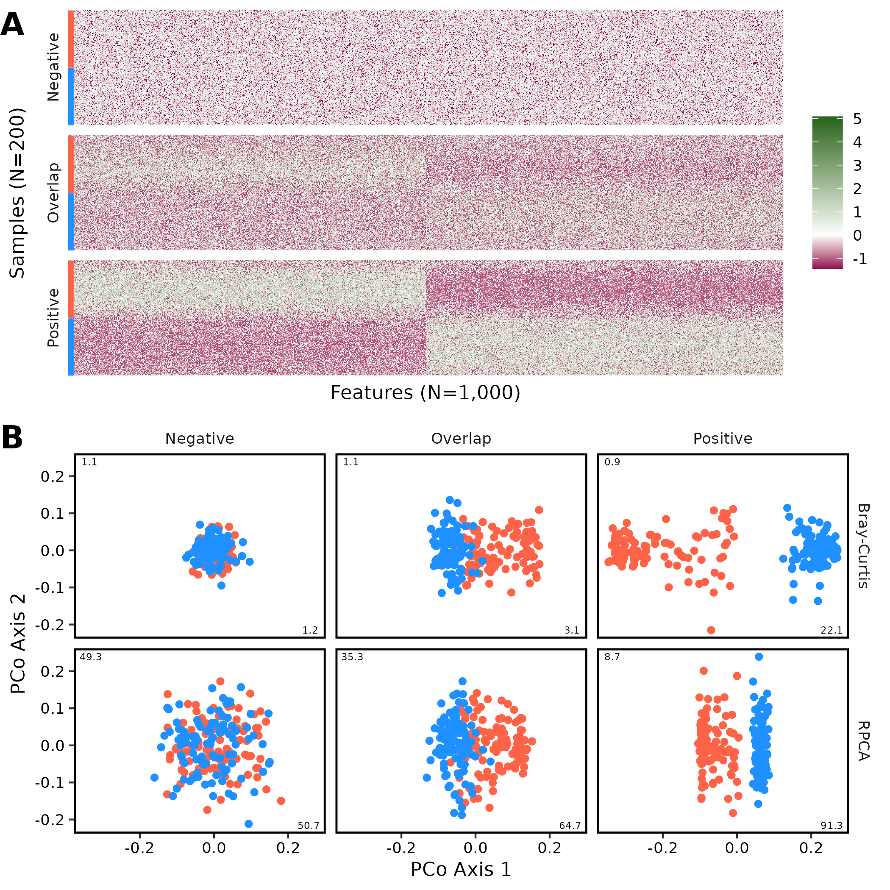{width=80%}

**Figure 1. Rerunning the original Martino code in my computational environment produced qualitatively similar results to what the originally reported when 4,000 sequences were sampled from each sample.** This figure is analogous to Figure 3DE of Martino with the inclusion of additional data from simulations where there was partial overlap between the two treatment groups ("Overlap"). The red and blue bars on the left edge of the heatmap indicate the treatment group that each sample belonged to. The heatmaps display the OCLR transformation of sequence counts. In addition to the RPCA output, I also provide the PCoA diagrams using Bray-Curtis distances. The numbers on the x and y axis of each ordination diagram represent the percent of the total variation that each axis explained.



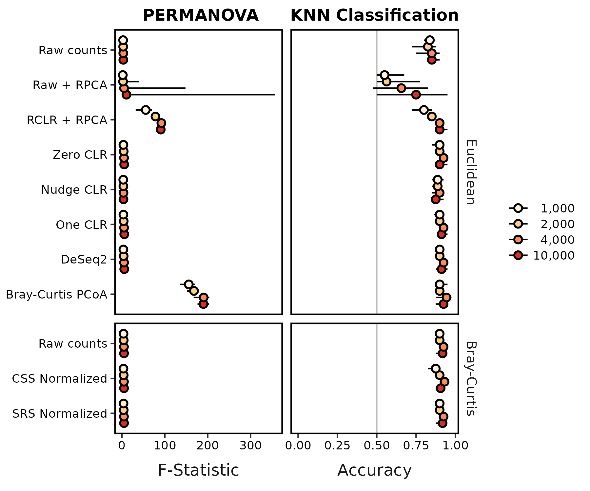{width=80%}

**Figure 2. RPCA-based methods did not consistently perform as well as other methods by PERMANOVA or KNN classification when attempting to distinguish between overlapping communities.** This figure includes data that was shown in in Figure 3BC of Martino with the inclusion of results when using additional data transformations, Bray-Curtis distances, and I used 10 instead of 1 replicate simulation. Each circle represents the median of ten replicate simulations and the confidence line indicates the range between the minimum and maximum values. The median KNN classification accuracy and range were the median of 10 median values each calculated across 100 training-testing splits using the fitted K value from 80-20 splits. The vertical gray line for KNN classification indicates the accuracy one would expect from randomly guessing the treatment group.



```{r}
p_ex <- permanova %>%
  filter(depth == 10000 & str_detect(dataset, "pds") & rep == 1) %>%
  select(dataset, process, distance, p_value) %>%
  filter((process == "raw" & distance == "bray") | (process == "gemelli_2" & distance == "euclidean"))

p_ex_pos_b <- filter(p_ex, dataset == "positive_pds" & process == "raw")
p_ex_neg_b <- filter(p_ex, dataset == "negative_pds" & process == "raw")
p_ex_over_b <- filter(p_ex, dataset == "overlap_pds" & process == "raw")

p_ex_pos_e <- filter(p_ex, dataset == "positive_pds" & process == "gemelli_2")
p_ex_neg_e <- filter(p_ex, dataset == "negative_pds" & process == "gemelli_2")
p_ex_over_e <- filter(p_ex, dataset == "overlap_pds" & process == "gemelli_2")
```

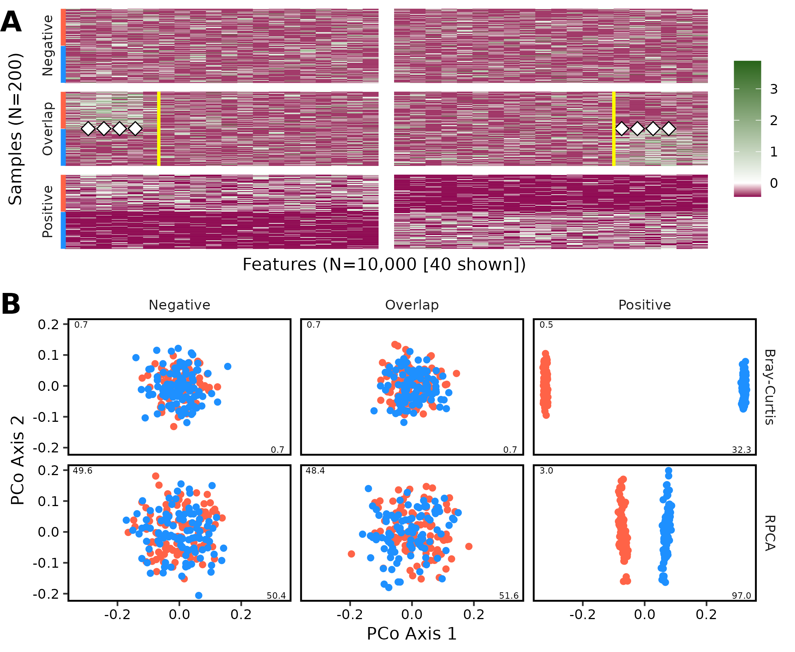{width=80%}

**Figure 3. Graphical representation of an example dataset comparing communities simulated rewritten in R based on the description in Martino when 10,000 sequences were sampled from each sample.** This figure is analogous to Figure 1. To highlight differences in overlap simulation, only the first and last 20 features from each sample are shown. The vertical white band indicates the break in the data presentation. The yellow vertical lines on the heatmap indicate the 12 features that were differentially represented in the two treatment groups. The white diamonds indicate features that had significantly different relative abundances when tested by a Wilcoxon test with P-values corrected using a Benjamini-Hochberg correction. For this example, the differences between the positive control (P=`r p_ex_pos_b$p_value`) and overlap dataset (P=`r p_ex_over_b$p_value`) were significant by PERMANOVA  and non-significant for the negative control (`r p_ex_neg_b$p_value`) using Bray-Curtis distances and significant for the positive control (`r p_ex_pos_e$p_value`) and non-significant for the overlap dataset (`r p_ex_over_e$p_value`) and negative (P=`r p_ex_neg_e$p_value`) control using RPCA.



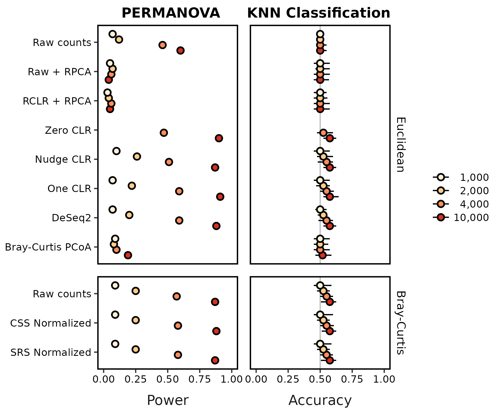{width=80%}

**Figure 4. Relative to other methods, RPCA-based methods were not as effective at differentiating between groups of communities using PERMANOVA and KNN classification when using a revised simulation approach.** This figure is analogous to Figure 2 except that it uses 100 instead of 10 replicates and the power to detect differences by PERMANOVA is shown instead of the Fst statistic. Each circle represents the median of the 100 replicate simulations and the confidence line indicates the range between the minimum and maximum values. The median KNN classification accuracy and range were the median of 10 median values each calculated across 100 training-testing splits using the fitted K value from 80-20 splits. The vertical gray line for KNN classification indicates the accuracy one would expect from randomly guessing the treatment group. The power and accuracy values for 1,000 and 2,000 sequences per sample when using Zero CLR were not calculated since the data were too sparse for the imputation algorithm to complete. 



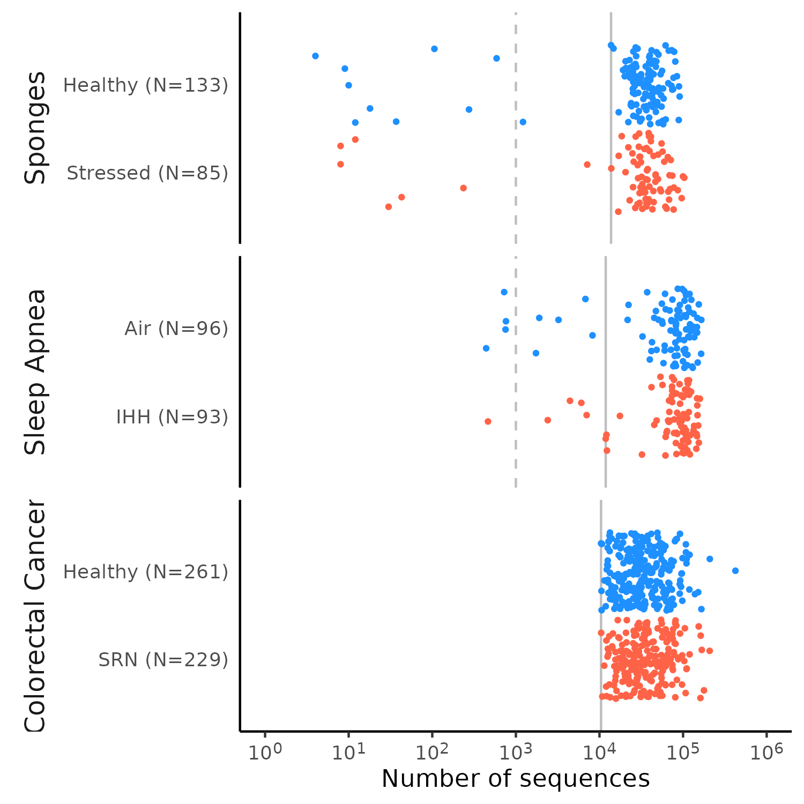

**Figure 5. Martino selected an arbitrarily small number of sequences and a pair of datasets that were small relative to other available datasets.** The vertical dashed line indicates the 1,000 sequence threshold, which was used by Martino and colleagues when calculating Bray-Curtis and weighted UniFrac distances. The vertical solid line indicates the higher threshold that was added in this study to explore the effects of sequencing depths. The higher threshold was `{r} nseqs_cs$sleep_apnea` sequences for the sleep apnea dataset, `{r} nseqs_cs$sponges` sequences for the sponges dataset, and `{r} nseqs_cs$crc` sequences for the CRC dataset.



```{r}
outlier <- permanova %>%
  filter(
    nsamples_per_group == "all" & dataset == "sleep_apnea" &
      process == "bray_pcoa"
  ) %>%
  mutate(depth_chr = if_else(depth == 1000, "low", "high")) %>%
  select(dataset, depth_chr, f_statistic) %>%
  pivot_wider(names_from = depth_chr, values_from = f_statistic) %>%
  mutate(diff = format(round(100 * (high - low) / low, 0))) %>%
  pull(diff)
```

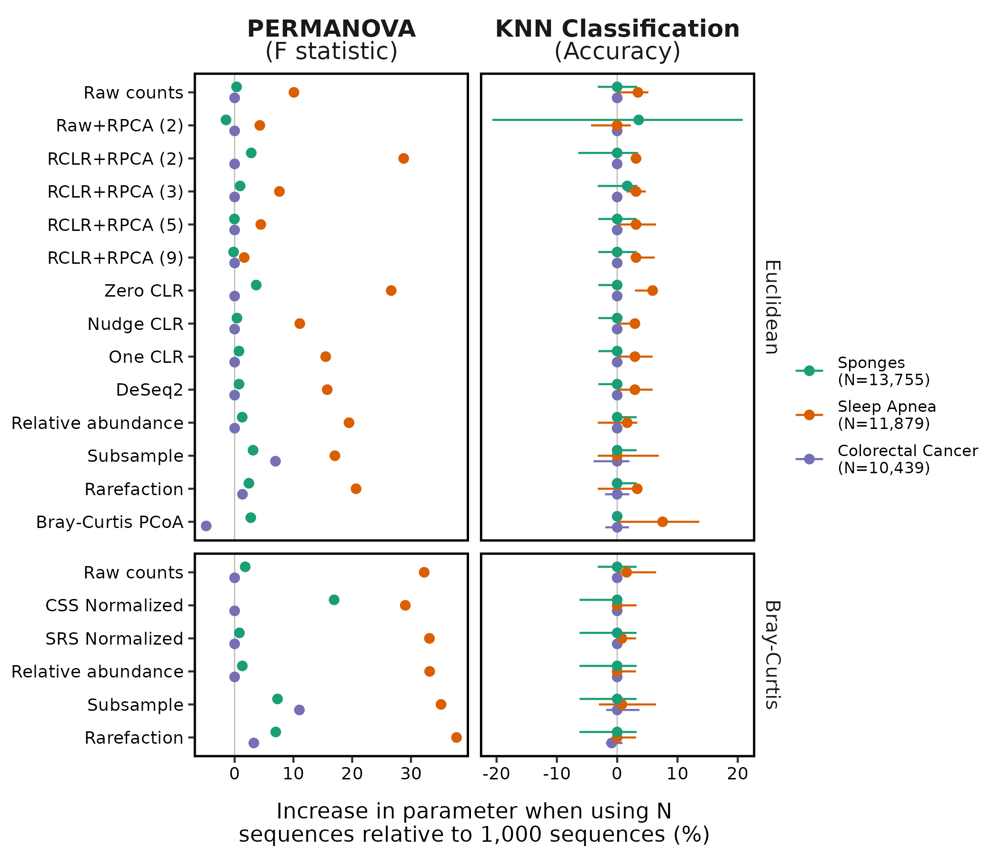

**Figure 6. Increasing the minimum number of sequences per sample from 1,000 to more than 10,000 resulted in larger PERMANOVA Fst test statistics and KNN accuracies.** Calculation of the difference in Fst was performed using values obtained when running PERMANOVA with all available samples. The difference in Bray-Curtis PCoA values was `r outlier`% and is not shown for the sleep apnea dataset because it was so much larger than the other values. Calculation of the difference in classification accuracy was performed using the largest possible balanced design, which included `{r} nsamples_cs$sponges` samples for the sponges dataset, `{r} nsamples_cs$sleep_apnea` samples for the sleep apnea dataset, and `{r} nsamples_cs$crc` samples for the CRC dataset. Because 10 iterations of the sample subsampling were performed we measured the difference in accuracy for each iteration. Each point represents the median difference and the confidence intervals represent the range. The vertical gray lines indicate where the Fst or accuracy was not different between using 1,000 sequences and the number of sequences indicated for that dataset in the legend.




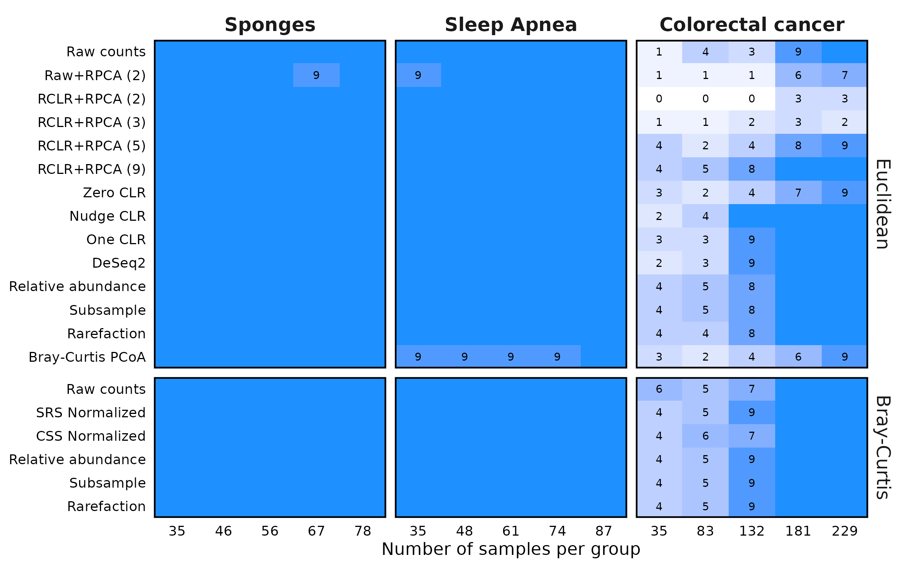

**Figure 7. Although all methods perform well on datasets with a large effect size between treatment groups, the RPCA-based methods suffer relative to the others when the effect size is smaller.** Each dataset was subsampled to the indicated number of samples per treatment group. For each of ten subsamplings, PERMANOVA was used to differentiate between the treatment groups. The number in the tile indicates the number of subsamplings that yielded a P-value less than 0.05. The blue tiles without numbers indicate those conditions where all 10 subsamplings yielded a significant result.



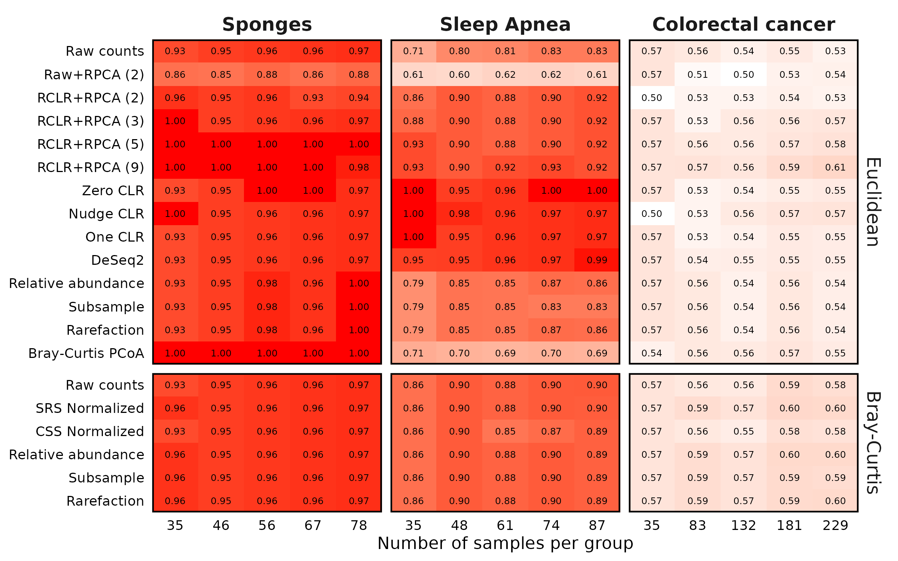

**Figure 8. The RPCA-based methods performed worse or at best, no better, than other methods for classifying samples when using KNN classification.** Each dataset was subsampled to the indicated number of samples per treatment group 10 times and was used to train and test a KNN classifier. The value in each cell is the median accuracy amongst those subsamplings.



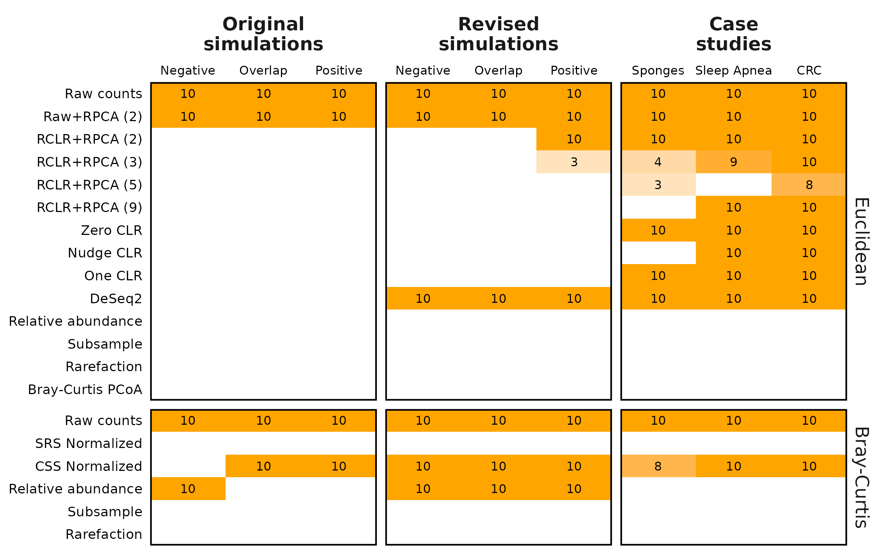

**Figure 9. RPCA did not alleviate clustering of samples by sequencing depth; rarefaction and subsampling did.** The numbers within each cell indicate the number of simulations out of 10 that falsely gave a significant P-value for the comparison of sequencing depth. Cells without a number had no falsely significant P-values. Synthetic versions of each dataset were generated where each sample was subsampled to 5,000 and 10,000 sequences, combined, processed, and analyzed by a two-factor PERMANOVA. Each simulation was repeated 10 times.


## Supplemental Figures

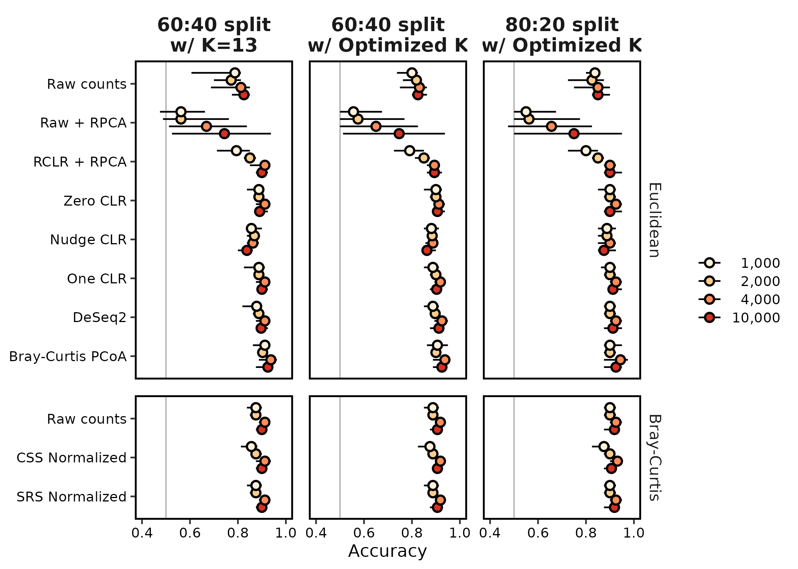

**Figure S1. The choice of K and the size of the training and testing data sets had a minimal effect on KNN classification accuracy when using the original Martino overlap simulation data.** Martino split 60% of their data into a training set using 13 neighbors and tested on the remaining 40%. Following Topcuoglu et al. [**XXXXX**], I optimized the number of neighbors using 60-40 and 80-20 training-testing splits. The 80-20 data were used in this analysis.




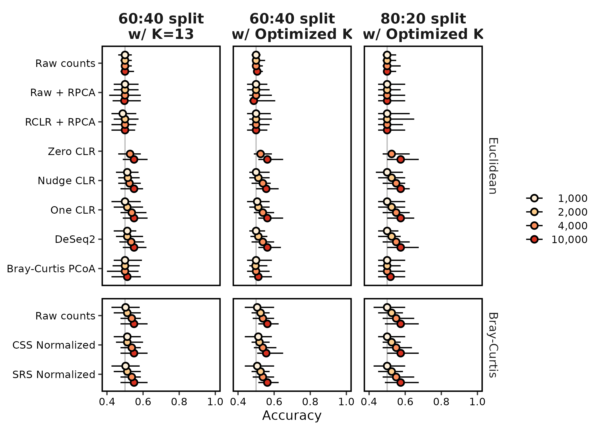

**Figure S1. The choice of K and the size of the training and testing data sets had a minimal effect on KNN classification accuracy when using the data generated by the revised simulation code.** Martino split 60% of their data into a training set using 13 neighbors and tested on the remaining 40%. Following Topcuoglu et al. [**XXXXX**], I optimized the number of neighbors using 60-40 and 80-20 training-testing splits. The 80-20 data were used in this analysis.
