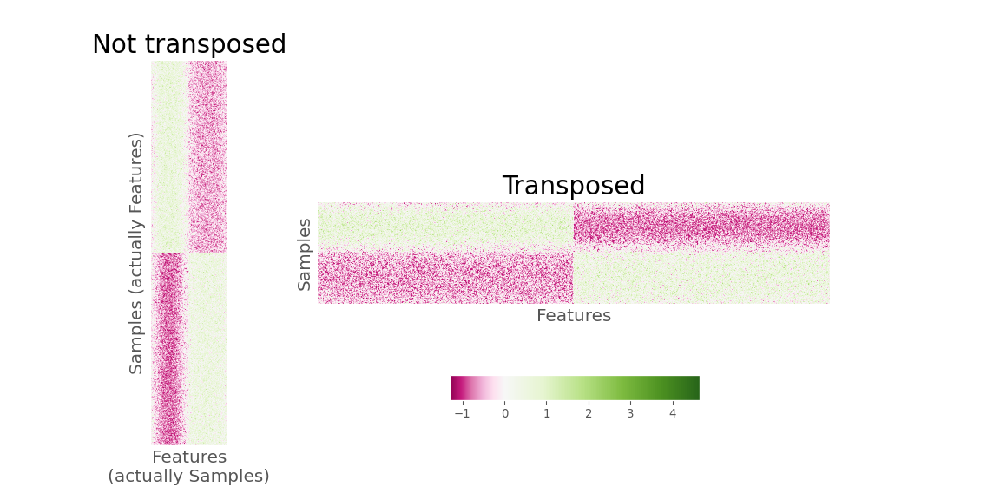
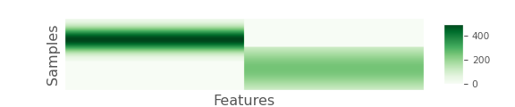
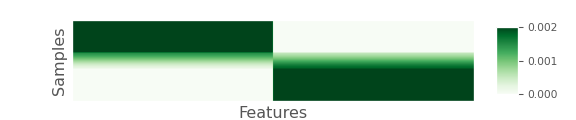
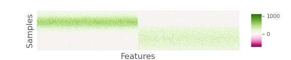
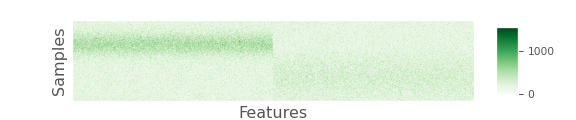
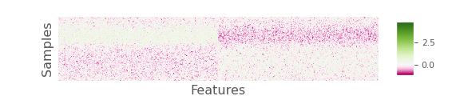

\RecustomVerbatimEnvironment{verbatim}{Verbatim}{
  showspaces = false,
  showtabs = false,
  breaksymbolleft={},
  breaklines
}

The code chunks displayed below were copied directly from the code used
by Martino et al. [(1)](%22Martino%22) and the line numbers correspond
to the indicated files. The hyperlinks in the text go to the GitHub
repository for the [current
project](https://github.com/SchlossLab/Schloss_RPCA_mSystems_2026),
which was a copy of the [original
repository](https://github.com/cameronmartino/deicode-benchmarking)
developed by Martino. Martino’s repository was [forked from the Deicode
repository](https://github.com/biocore/DEICODE/commit/ea7835b9a0d16c35685542a81d05ee12c412c6ba)
on January 28, 2019. The only changes between the Martino repository and
the copy for this project was to make the directory and file names
lowercase and to replace hyphens with underscores.

# Review of code used to generate positive and negative control heatmaps in Figure 3DE of Martino

Review of the code in
[`deicode_benchmarking/simulations/negative_control.ipynb`](https://github.com/SchlossLab/Schloss_RPCA_mSystems_2026/blob/main/deicode_benchmarking/simulations/negative_control.ipynb)
revealed two important problems with the generation of Martino’s Figure
3DE. For background, the `X_random` and `X_signal` matrices represented
the negative and positive controls, respectively, that were generated in
an earlier block of this notebook. For both matrices, there were 1000
rows for each feature or taxon and 200 columns for each sample. At L13
and L15 of block 183, the [`imshow`
function](https://matplotlib.org/stable/api/_as_gen/matplotlib.pyplot.imshow.html)
from the pyplot package within the `matplotlib` Python library was used
to generate heatmaps of the two matrices.

``` python
#show the results
fig,((ax1,ax2),(ax3,ax4)) = plt.subplots(2,2,figsize=(12,8))

ax1.imshow(clr(X_signal+1),aspect='auto',norm=MidpointNormalize(midpoint=0.), cmap='PiYG')
ax1.set_title('Positive Control Simulation',fontsize=22)
cbim = ax2.imshow(clr(X_random+1),aspect='auto',norm=MidpointNormalize(midpoint=0.), cmap='PiYG')
ax2.set_title('Negative Control Simulation',fontsize=22)
```

Within the arguments to `imshow` (L13), the matrices were transformed by
adding 1 to each cell and then subjecting the matrices to a central log
ratio transformation with the [`clr`
function](https://scikit.bio/docs/dev/generated/skbio.stats.composition.clr.html#skbio.stats.composition.clr)
from the composition statistics module of the `skbio` Python library. It
is important to note that the `clr` function assumed that the rows
represented compositions or samples and the columns represented the
components or taxa. Therefore, `X_random` and `X_signal` should have
been transposed prior to performing the clr transformation. For example,
earlier at L2 and L6 of the same code block, the matrices were
transposed prior to using the `rclr` function.

``` python
#RPCA on random
X_random_rclr = rclr().fit_transform(X_random.T)
opt_noise = OptSpace().fit(X_random_rclr)
U_random = pd.DataFrame(opt_noise.sample_weights,index=X_random.columns)
#RPCA on very clear signal
X_signal_rclr = rclr().fit_transform(X_signal.T)
opt_sig = OptSpace().fit(X_signal_rclr)
U_signal = pd.DataFrame(opt_sig.sample_weights,index=X_signal.columns)
```

As executed in the notebook, the result of using the `clr` function was
the same shape as the input matrices with features as rows and samples
as columns. The transformed data were then used in the `imshow` function
which plotted the rows and columns of the matrix to the rows and columns
of the heatmap. However, at L21-24 in the same code block, “Samples” was
added to the y-axis label and “Features” was added to the x-axis label,
which was the reverse of the actual situation. These problems hid the
fact that samples rather than taxa were shared between the treatment
groups. Of course, sharing samples between treatment groups would not
make sense and instead the taxa should have been shared.

``` python
ax2.set_ylabel('Samples',fontsize=15)
ax1.set_ylabel('Samples',fontsize=15)
ax2.set_xlabel('Features',fontsize=15)
ax1.set_xlabel('Features',fontsize=15)
```

The problem with the labelling of the axes could be more clearly seen by
changing the value of the `aspect` argument in `imshow` from `'auto'` to
`None` on L13-14. To summarize, the code in this block (i) performed the
CLR transformation across the samples rather than across the taxa and
(ii) mislabelled the axes of the heatmaps in Martino’s Figure 3DE. Both
problems could have been avoided by transposing the matrices within the
arguments to `clr` at L13 and L15. The comparison between transposing
the data or not are are shown below.



# Review of `build_block_model` function and its dependencies

Because it was clear that there was a problem in the simulation code
such that samples rather than taxa were shared between treatment groups,
I reviewed the code in
[`build_block_model`](https://github.com/SchlossLab/Schloss_RPCA_mSystems_2026/blob/main/deicode_benchmarking/simulations/scripts/simulations.py#L175)
and related functions to better diagnose the problems in the simulation.
The `build_block_model` function was found in
[`deicode_benchmarking/simulations/scripts/simulations.py`](https://github.com/SchlossLab/Schloss_RPCA_mSystems_2026/blob/main/deicode_benchmarking/simulations/scripts/simulations.py).
The function was called in
`deicode_benchmarking/simulations/negative_control.ipynb` to generate
the positive control data in Martino’s Figure 3D and in
`deicode_benchmarking/simulations/scripts/cluster_build.py` to generate
the overlapping data analyzed in Martino’s Figure 3ABC. The
`build_block_model` function is listed below except for lines
corresponding to comments (L185-236) and code that did not impact the
generation of `X_noise` (L244-253 and L262-267). The function returned
the values of `X_true` and `X_noise`.

``` python
def build_block_model(
        rank,
        hoced,
        hsced,
        spar,
        C_,
        num_samples,
        num_features,
        overlap=0,
        mapping_on=True):
```

``` python
    X_true = block_diagonal_gaus(
      num_samples,
      num_features,
      rank,
      overlap,
      minval=.01,
      maxval=C_)
```

``` python
    X_noise = X_true.copy()
    X_noise = np.array(X_noise)
    # add Homoscedastic noise
    X_noise = Homoscedastic(X_noise, hoced)
    # add Heteroscedastic noise
    X_noise = Heteroscedastic(X_noise, hsced)
    # Induce low-density into the matrix
    X_noise = Subsample(X_noise, spar, num_samples)
```

As called in `cluster_build.py`, the value of `rank` was 2 (i.e., the
number of treatment groups), `num_samples` was 200 (i.e., the number of
samples across all treatment groups), `num_features` was 1000 (i.e.,
number of taxa or features), and `overlap` was 20 (i.e., the number of
features that overlapped between the treatment groups; it was zero in
the positive control analysis). The values of `spar`, `C_`, `hoced`, and
`hsced` were based on a parameter that was altered for each sequencing
depth. The `spar` and `C_` values were set to the same value (e.g.,
2500) and were used to scale the relative abundance values in the
`Subsample` (L261) and `block_diagonal_gaus` (L237-243) functions,
respectively. As used in the simulations with partially overlapping
features the `hoced` and `hsced` values were set to `hoced` and `hsced`
values divided by 15; for the positive control analysis they were
divided by 60. These values were used in the `Homoscedastic` (L257) and
`Heteroscedastic` (L259) functions where `hoced` and `hsced` were used
to set the standard deviation of a normal distribution with mean set to
the relative abundance of the sample-taxon pair receiving additional
noise uniformly or randomly. The values of `spar`, `C_`, `hoced`, and
`hsced` used in `build_block_model` were selected by fitting the model
to experimental data from a study comparing the microbial communities on
subject’s fingers and keyboards. Although I did not attempt to replicate
their model fitting, other code was found in `simulations.py` that
ostensibly performed this analysis.

I noticed that when I loaded `simulations.py` and ran
`build_block_model` multiple times with the same input data and random
number generator seed, the code did not produce the same results.
Although not a critical problem, the lack of computational
reproducibility was part of my motivation to assess the benchmarking
test results obtained with ten rather than only one seed.

Finally, comments in `build_block_model` described the function as
returning a data frame with `num_samples` rows and `num_features`
columns (L223-227). In fact, it returned a data frame with
`num_features` rows and `num_samples` columns. This may account for why
samples rather than features overlapped in the `block_diagonal_gaus`
function. This issue is described further in the next section.

``` python
    Returns
    -------
    Pandas Dataframes
    Table with a block diagonal where the rows represent samples
    and the columns represent features.  The values within the blocks
    are gaussian.
```

## Review of `block_diagonal_gaus` function

The function
[`block_diagonal_gaus`](https://github.com/SchlossLab/Schloss_RPCA_mSystems_2026/blob/main/deicode_benchmarking/simulations/scripts/simulations.py#73)
created a model that described the abundance of each taxon across the
samples for each treatment group before any noise was applied to the
data. This function was called by `build_block_model` and was also found
in
[`deicode_benchmarking/simulations/scripts/simulations.py`](https://github.com/SchlossLab/Schloss_RPCA_mSystems_2026/blob/main/deicode_benchmarking/simulations/scripts/simulations.py).

``` python
def block_diagonal_gaus(
        ncols,
        nrows,
        nblocks,
        overlap=0,
        minval=0,
        maxval=1.0):
```

As used in Martino, `ncols` was 200 and `nrows` was 1000. As described
in the Methods of the original study, the model used a normal
distribution to vary the relative abundance of each taxa with different
distributions for each treatment group such that a specified fraction of
taxa overlapped between the two treatment groups. Within
`block_diagonal_gaus` the number of treatment groups was specified with
`nblocks`, which was 2 and the overlap was specified with `overlap`,
which was 20 for the partial overlap simulation and 0 for the positive
control simulation. The value of `maxval` was used to scale relative
abundance values in the function and was set to the parameter described
in the previous section (e.g., 2500 for a sequence depth of 4000). The
function generated a matrix with `ncols` samples and `nrows` taxa;
however, comments in the function described a transposed version of the
matrix. In addition, as I’ll show below, the output was not a block
diagonal.

``` python
    Returns
    -------
    np.array
        Table with a block diagonal where the rows represent samples
        and the columns represent features.  The values within the blocks
        are gaussian distributed between 0 and 1.
```

``` python
    if nblocks <= 1:
        raise ValueError('`nblocks` needs to be greater than 1.')
    mat = np.zeros((nrows, ncols))
    gradient = np.linspace(0, 10, nrows)
    mu = np.linspace(0, 10, ncols)
    sigma = 1
    xs = [norm.pdf(gradient, loc=mu[i], scale=sigma)
          for i in range(len(mu))]
    mat = np.vstack(xs).T
```

The function began by initializing a matrix with zeroes (i.e., `mat`)
and a gradient of values to define a distribution (i.e., `gradient`).
However, this code was largely superfluous since the values of these
parameters were written over by subsequent code before the matrix (i.e.,
`mat`) was updated. Regardless, operationally, `mat` was defined as a
matrix of zeroes with `num_features` rows and `num_samples` columns
(L119). A vector with `num_features` values, `gradient`, was defined as
a linear interpolation between the values of 0 and 10 (L120). Similarly,
a vector with `num_samples` values, `mu`, was defined as a linear
interpolation between the values of 0 and 10 (L121). These values along
with a `sigma` value of 1 were used to create a `num_samples` long
vector of arrays, which were each `num_features` long (L123-124). This
vector of arrays, `xs`, took its values from the Normal probability
density function (i.e., `norm.pdf`) at the `num_features` values of
`gradient` under a distribution with a mean at each of the `num_samples`
values of `mu` with a standard deviation of `sigma` (i.e., 1). The
`num_features` by `num_samples` matrix `mat` was generated by combining
each element of `xs` as the columns. As suggested in the comment above
from L108-110, this matrix had maximum probabilities along the diagonal
of the matrix. Values far off the diagonal were nearly zero. For
example, the value for the first feature in the first sample was 0.3989
and it was 7.7e-23 in the last sample. The following heatmap shows the
raw values in the matrix (the matrix has been transposed).


As stated above in my description of L117-125, the values of `mat` were
largely overwritten by the following lines of code.

``` python
    block_cols = ncols // nblocks
    block_rows = nrows // nblocks
    for b in range(nblocks - 1):

      gradient = np.linspace(5, 5, block_rows)  # samples (bock_rows)
      # features (block_cols+overlap)
      mu = np.linspace(0, 10, block_cols + overlap)
      sigma = 2.0
      xs = [norm.pdf(gradient, loc=mu[i], scale=sigma)
            for i in range(len(mu))]

      B = np.vstack(xs).T * maxval
              lower_row = block_rows * b
              upper_row = min(block_rows * (b + 1), nrows)
              lower_col = block_cols * b
              upper_col = min(block_cols * (b + 1), ncols)

              if b == 0:
                  mat[lower_row:upper_row, lower_col:int(upper_col + overlap)] = B
              else:
                  ov_tmp = int(overlap / 2)
                  if (B.shape) == (mat[lower_row:upper_row,
```

L127 and L128 defined the number of columns (`block_cols`) and rows
(`block_rows`) in each block. Because `nblocks` was 2 for all
simulations, these values became 100 and 500, respectively. At L129, a
loop was initiated for values of an index variable, `b`, which ranged
between 0 and the integer less than `nblocks-1` or 0. Therefore, the
loop was only executed once and the else statement at L146-159 was never
executed. At L131 and L133 new versions of `gradient` and `mu` were
generated. All the values in `gradient` were 5 and the values in `mu`
were taken from a linear extrapolation between 0 and 10. The vector `mu`
had `block_cols` (i.e., 100) plus `overlap` (i.e., 20) values. Because
the columns contained sample data, the additional 20 columns represented
20 additional samples rather than features. **This was further evidence
that Martino’s simulation considered the overlap of samples rather than
features.** The code that was described at L123-125 was repeated as
L135-138, using a standard deviation of 2 rather than 1. The resulting
matrix, `B`, had 500 rows and 120 columns. Each row of `B` was identical
with the columns being the value of the probability distribution
function at 5.0 (i.e., `gradient` as defined at L131) for a normal
distribution with the 120 values of `mu` as the mean and 2.0 (i.e.,
`sigma`) as the standard deviation. At L145, this matrix was used to
replace the values in the upper left quadrant of `mat` in L139-145. The
values of the first 500 rows in the last 80 columns were all nearly zero
and were taken from the value of `mat` generated at L125.

The code shown below was similar to what was done at L131-138.

``` python
    upper_col = int(upper_col - overlap)
    # Make last block fill in the remainder
    gradient = np.linspace(5, 5, nrows - upper_row)
    mu = np.linspace(0, 10, ncols - upper_col)
    sigma = 4
    xs = [norm.pdf(gradient, loc=mu[i], scale=sigma)
          for i in range(len(mu))]
    B = np.vstack(xs).T * maxval

    mat[upper_row:, upper_col:] = B
```

The only difference was that in this code chunk they used a standard
deviation of 4.0 (i.e., `sigma`) instead of 2.0. The new value of `B`
defined at L168 was used to complete the value of `mat` by filling in
the last 500 rows and the last 120 columns (L170). Again, the values of
the first 80 columns in the last 500 rows were nearly zero.

In conclusion, there were three issues with the code in the
`block_diagonal_gaus` function. First, the code at the beginning of the
function (L117-125) was extraneous. Second, and more important, the
features had the same relative abundance within each sample. Finally,
and perhaps most important, samples were shared across features rather
than features being shared across samples. As written in the original
Jupyter notebook, the at the end of the `block_diagonal_gaus` function,
values of `ncols` set to 200, `nrows` to 1000, `nblocks` to 2, `overlap`
to 20, and `maxval` to 2500 resulted in a 1000 row by 200 column matrix.
Below is a heatmap depiction of the raw values in `mat` with lighter
colors are lower abundance while darker colors are higher abundance.



To highlight the observation that the probabilities were the same for
each feature across non-overlapping samples within the same block, the
following heatmap shows the relative abundances of each feature:



## Review of `Homoscedastic`

The `Homoscedastic` function applied noise generated by randomly
sampling from a normal distribution to each sample-taxon pair of the
matrix using the abundance of the sample-taxon pair as the mean and
`intensity` as the standard deviation. For the cases where overlap was
included between the treatment groups, the intensity was the model
parameter (e.g., 2500) divided by 15 (i.e., 166.6667) and for the case
where there was no overlap between the treatment groups, the intensity
was the model parameter divided by 60 (i.e., 41.6667).

``` python
def Homoscedastic(X_noise, intensity):
    """ uniform normally dist. noise """
    X_noise = np.array(X_noise)
    err = intensity * np.ones_like(X_noise.copy())
    X_noise = rand.normal(X_noise.copy(), err)

    return X_noise
```

The code from L42-48 revealed another potential problem. The median
abundance in `X_noise` coming into `Homoscedastic` across all samples
was 115.7 with a maximum value of 498.6 (see the two previous heatmaps).
Considering that random numbers were drawn from distributions with a
standard deviation of 166.67 it was likely that negative values would
result. In fact, for this example, 28.5% of the sample-taxon pairs were
negative. The normal distribution likely should have been truncated by
turning negative values to zeroes. Below is a heatmap depiction of
`X_noise` after running the `Homoscedastic` function on L257 of the
`build_block_model` function in `simulations.py`.



## Review of `Heteroscedastic`

Similar to `Homoscedastic`, the `Heteroscedastic` function applied noise
randomly sampled from a normal distribution using the abundance of the
sample-taxon pair from `X_noise` as the mean and `intensity` as the
standard deviation. Again, for the simulations of the partially
overlapping features between treatment groups, the intensity was the
model parameter (e.g., 2500) divided by 15 (i.e., 166.6667) and for the
case where there was no overlap between the treatment groups, the
intensity was the model parameter divided by 60 (i.e., 41.6667). The
“Simulations” subsection of the “Materials and Methods” section of
Martino indicated that the heteroscedastic source of noise was only
supposed to be applied to a random subset of the sample-taxon pairs.
However, review of the code for the `Heteroscedastic` function indicated
that it applied noise to all values of `X_noise` rather than to a
subset.

``` python
def Heteroscedastic(X_noise, intensity):
    """ non-uniform normally dist. noise """
    err = intensity * np.ones_like(X_noise)
    i = rand.randint(0, err.shape[0], 5000)
    j = rand.randint(0, err.shape[1], 5000)
    err[i, j] = intensity
    X_noise = abs(rand.normal(X_noise, err))

    return X_noise
```

At L53 the code generated `err`, which was a matrix with the same
dimensions as `X_noise` where every cell had the value of the intensity
(e.g., 166.67). On L54-55 they selected 5000 random row and column
indices that were then used in L56 to assign values of `err` to
`intensity`. Except, L54-56 did not change the existing values of `err`
since the values in the matrix were all already set to the value of
`intensity` at L53. At L57, noise was added to all values of `X_noise`
much like was done in `Homoscedastic` at L46. It was likely that the
authors intended to use the numpy `zeros_like` function on L53 instead
of the `ones_like` function. Then at L56, `err` would have had 5000
cells with the value of `intensity` and the `rand.normal` function would
have changed only those values at L57. One notable difference to
`Homoscedastic` was that L57 used `abs` to return the absolute value of
`rand.normal`. Prior to applying the absolute value to the abundances
with the additional noise, 32.2% of the sample-taxon pairs were
negative. Using `abs` would certainly add noise to a subset of
`X_noise`, but it would not be random since it would disproportionately
impact low abundance features. As mentioned for `Homoscedastic`,
returning zero rather than negative values or their absolute value would
likely have been preferred. Below is a heatmap depiction of `X_noise`
after running the `Heteroscedastic` function on L259 of the
`build_block_model` function in `simulations.py`.



## Review of `Subsample`

In the final step of `simulations.py`, the values of `X_noise` were used
to generate a count matrix with the desired number of individuals per
sample (L261) using the `Subsample` function.

``` python
def Subsample(X_noise, spar, num_samples):
    """ yij ~ PLN( lambda_{ij}, /phi ) """
    # subsample
    mu = spar * closure(X_noise.T).T
    X_noise = np.vstack([poisson(lognormal(np.log(mu[:, i]), 1))
                         for i in range(num_samples)]).T
    # add sparsity

    return X_noise
```

This function took `X_noise` as input along with the `spar` and
`num_samples` parameters. The value of `spar` was the same model
parameter value that was used to scale the relative abundances in
`block_diagonal_gaus` (e.g., 2500). At L54, the relative abundance of
features within each sample was determined and then multiplied by `spar`
to generate `mu` which was a `num_features` by `num_samples` array.
These values were used to generate counts for each sample-taxon pair
using a Poisson-lognormal distribution, which produced a new version of
`X_noise`, which was returned to `build_block_model` and used for the
rest of the analysis.

Below is a heatmap depiction of the central log ratio transformation of
`X_noise` after adding 1 to each cell at the end of the
`build_block_model` function in `simulations.py`.



The matrix generated from `Subsample` did not have a consistent total
number of counts for each sample. When using the model parameter of
2500, values near 4000 individuals per sample were obtained, but there
was considerable variation. Using the model parameter value of 2500, the
mean number of individuals per sample was 4112.475 with a range between
3420 and 4896. Considering the claim that RPCA is invariant to
differences in sampling effort, it was desirable to control whether
samples had the same number of individuals. As a workaround for this
problem, I increased the model parameter (e.g., from 2500 to 2800) so
that the minimum sample size was greater than the desired number of
individuals and then down sampled each sample to the desired number.

## Summary

Seven problems were found in the code as written in the original
`simulations.py` script. They are listed here in order of importance.

**1. Samples, not features, were shared between the two treatment
groups.** The intention was that features should be shared between
treatment groups, not samples.  
**2. Among samples from the same treatment group, the abundance
distributions for each feature were uniform.** The result was that the
relative abundance for all features in the same sample and treatment
group had the same expected relative abundance. The intention was likely
that the abundance distribution within each sample varied by feature.  
**3. The total number of individuals varied across each sample.**
Although there were claims that RPCA was insensitive to uneven sampling
effort, this was not actually demonstrated in Martino. It was necessary
for me to make the sampling effort uniform so this could be tested.  
**4. The heteroscedastic source of noise was actually applied to all
sample-taxon pairs.** The result was a second addition of noise to all
sample-taxon values rather than the intended subset of values.  
**5. Negative mean values were used as the mean in normal distribution
sampling functions when calculating the heteroscedastic noise.** It was
likely that the intention was for negative values to be transformed to
zeros before sampling the distribution.  
**6. The signs of negative values generated after applying the
heteroscedastic noise were made positive.** It was likely that the
intention was for negative values to be transformed to zeros.  
**7. Setting the random number generator seed was inadequate to ensure
that rerunning `simulations.py` with the same parameters yielded the
same result.**

Taken together, these problems did not entirely invalidate the claims
made by Martino about the performance of RPCA. Regardless, it was
necessary to re-evaluate the claims with corrected code. Therefore, I
rewrote `simulations.py` as an R script `simulations.R` (found in
`workflow/scripts/`) that resolved the above-mentioned problems.

# Review of simulation analysis code

Continuing my review of the code used in the published benchmarking
analysis of the simulated data, I inspected the code that was used to
calculate the PERMANOVA F statistics and P-values and k-Nearest Neighbor
(KNN) accuracy values. Review of the code in
`deicode_benchmarking/simulations/negative_control.ipynb` and
`deicode_benchmarking/simulations/scripts/cluster_build.py` and the data
outputted to
`deicode_benchmarking/simulations/cluster_models/simulation_subsampled_noisy.csv.gz`
made it clear that each simulation (i.e., negative, positive, and
overlapping) was only replicated a single time. This would have made it
impossible to assess the sensitivity of the simulation results on the
choice of the random number generator seed.

Aside from the lack of simulation replication, my primary critique
concerned the KNN analysis. The manuscript stated “ordination output was
compared by permutational multivariate analysis of variance (PERMANOVA)
F-statistic and supervised k-nearest neighbor (KNN) classification
cross-validation (40:60) split”. The convention for describing
cross-validation splits is to indicate the percentage of samples used in
the training set followed by the percentage used in the testing set.
Therefore, according to a 40:60 split, 40% of the samples would have
been used to train the model and 60% would have been used to test the
model. Such a split would have been an odd choice since the training set
is typically larger than the testing set. Furthermore, a split is often
performed multiple times to remove bias from the selection of the random
number generator seed.

Analysis of the benchmarking code made it clear that a 40:60 split was
not used. In fact, for the negative and positive control analyses
reported in their Table S1, the authors used 80:20 training-testing
splits. This can be seen on L7 of box 186 from
`deicode_benchmarking/simulations/negative_control.ipynb` shown here:

``` python
pcoa_tmp = pcoa(DistanceMatrix(distance.cdist(U_,U_))).samples
pcoa_tmp.index = T_.T.index
# split
X_train, X_test, y_train, y_test = train_test_split(pcoa_tmp, meta['group'].ravel(), 
                                                    test_size=.2, 
                                                    stratify=meta['group'].ravel(), 
                                                    random_state=42)
knn = KNeighborsClassifier(n_neighbors=10).fit(X_train, y_train)
```

In contrast, to analyze the data simulated with overlapping features
they used 60:40 training-testing splits. This can be seen on L75 of
`deicode_benchmarking/simulations/scripts/cluster_results.py` as shown
here:

``` python
pcoa_tmp=pcoa(DistanceMatrix(distance.cdist(U_tmp,U_tmp))).samples
pcoa_tmp.index=subtmp_sub.index
# split
X_train, X_test, y_train, y_test = train_test_split(pcoa_tmp, meta['group'].ravel(), 
                                                    test_size=.4, 
                                                    stratify=meta['group'].ravel(), 
                                                    random_state=42)
knn = KNeighborsClassifier(n_neighbors=13).fit(X_train, y_train)
```

Review of the code in both `negative_control.ipynb` and
`cluster_results.py` made it clear that only a single split of the data
was performed.

The choice of the number of neighbors (i.e., hyperparameter k) used in
the KNN analysis was not described in the manuscript. Often the training
set will be repeatedly split to fit such hyperparameters (2). As shown
above in the code at L10 from box 186 from `negative_control.ipynb`, a k
value of 10 was used to classify the positive and negative control data.
In contrast, as shown above in the code from `cluster_results.py` at
L78, a k value of 13 was used to classify the samples with overlapping
features.

In summary, the authors used inconsistent splits and k-values in their
simulations, misstated the nature of the split, did not incorporate
multiple splits, and provided no information for how the k-value was
selected. These problems raised the question of whether their models
were overfit (i.e., too small of a k value) or under fit (i.e., too
large of a k value). Therefore, I implemented my own version of a KNN
classifier (`workflow/scripts/test_train_knn.R`) that allowed me to
input a distance matrix, training, validation, and testing fractions,
and the number of iterations.

# Review of case study analysis code

## Processing of case study datasets

After benchmarking RPCA using simulated data, Martino evaluated the
method relative to using Bray-Curtis and weighted UniFrac distances with
the Sponges and Sleep Apnea datasets (3, 4). Both datasets consisted of
two treatment groups represented by varying numbers of samples, each
with a wide distribution in the number of sequences (**Figure 5**). The
datasets were analyzed separately by similar methods. Before commenting
on the analysis of these datasets, several issues are noteworthy.

First, to create balanced experimental designs, the authors randomly
selected an equal number of samples from each treatment group. While
unbalanced design is problematic for KNN classification, PERMANOVA is
not known to be sensitive to such designs. To mitigate the effects of
the random number generator seed, they repeated this sampling. The text
of the manuscript states that they performed “10-fold random subsamples
of the data”. In fact, at L45 of
`deicode_benchmarking/case_studies/scripts/subsample.py` it was clear
that they only performed 9-fold random subsamples.

``` python
# repeat randomized sub-sample 10 fold times
for fold_ in range(1,10):
    # Randomly Sub-sample to balance groups
```

The python `range(start, stop)` function outputs values from the value
of `start` and ends at one less than `stop`. For example:

``` python
list(range(1, 10))
```

    [1, 2, 3, 4, 5, 6, 7, 8, 9]

Admittedly, this was unlikely to have had a meaningful impact on the
results of the case study analysis.

Second, Bray-Curtis and weighted UniFrac distances are known to be
sensitive to uneven sampling effort of the samples being compared;
Martino claimed that RPCA was not. To mitigate the effects of uneven
sequencing depth among samples, Martino performed a single subsampling
of the data down to 1,000 sequences per sample when calculating the
Bray-Curtis and weighted UniFrac distances; all samples with more than
1,000 sequences were used for RPCA without subsampling to a common
number of sequences. This was encoded at L38-49 and L61-62 from
`deicode_benchmarking/case_studies/scripts/distances.py`.

``` python
table_path = os.path.join(dir_path,subpath_,sub_set,'table.biom')
metadata_path_qiime = os.path.join(dir_path,subpath_,sub_set,'metadata.tsv')  
# make qiime2 table form biom 
table_path_qiime=os.path.join(dir_path,subpath_,sub_set,'table.qza')
subprocess.call("qiime tools import --input-path %s --type 'FeatureTable[Frequency]' --source-format BIOMV210Format --output-path %s"%(table_path,table_path_qiime), shell=True)
# sequencing depth cleaning (1000 read/sample)
subprocess.call("qiime feature-table filter-samples --i-table %s --p-min-frequency 1000 --o-filtered-table %s"%(table_path_qiime,table_path_qiime), shell=True)
# trim biom of any tree issues (should not be any but why not)
subprocess.call("qiime phylogeny filter-table --i-table %s --i-tree %s --o-filtered-table %s"%(table_path_qiime,tree_path_qiime,table_path_qiime), shell=True)
# rarefy (1,000)
subprocess.call("qiime feature-table rarefy --i-table %s --p-sampling-depth 1000 --o-rarefied-table %s"%(table_path_qiime,table_path_qiime), shell=True)
# bray-curtis
bray_dist = os.path.join(dir_path,subpath_,sub_set,'Bray_Distance.qza')
subprocess.call("qiime diversity beta --i-table %s --p-metric 'braycurtis' --o-distance-matrix %s"%(table_path_qiime,bray_dist), shell=True)
# generalized weighted alpha=1.0
wone_dist = os.path.join(dir_path,subpath_,sub_set,'GUniFrac_alpha_one_Distance.qza')
subprocess.call("qiime diversity beta-phylogenetic-alt --i-table %s --i-phylogeny %s --p-metric generalized_unifrac --p-alpha 1.0 --o-distance-matrix %s"%(table_path_qiime,tree_path_qiime,wone_dist), shell=True)           
```

``` python
# run RPCA
subprocess.call("deicode_rpca --in_biom %s --output_dir %s --rank %s --min_sample_depth 1000"%(table_path,sub_path_sub,str(ranks[dataset_])), shell=True)                
```

From this code, one will note on that `table_path_qiime` was created on
L37 and updated at L39 (filtering to remove samples smaller than 1,000
sequences), L41 (tree cleaning), and L43 (each sample subsampled once to
1,000 sequences). The data in `table_path_qiime` was used to calculate
Bray-Curtis and UniFrac distances at L46 and L49, respectively. When
RPCA was performed on L62, the input was `table_path`, which was created
on L33 and used as the input to create the biom-formatted file in the
initial version of the data in `table_path_qiime` (L37). It is also
worth noting that Bray-Curtis and weighted UniFrac distances from a
single subsampling were used rather than using the average of a large
number of subsamplings (e.g., 100) (5).

As shown in **Figure 5**, 1,000 appears to have been an arbitrary
threshold. It could have been greater than 10,000 sequences for both
datasets without losing a significant number of samples. That so many
more sequences were included in the RPCA analyses could create an
advantage to the sensitivity of RPCA over the other distance
calculations.

Third, the methods section of Martino stated, “Both data sets were then
preprocessed with the robust centered log ratio (rclr) transform, and
RPCA was run with a rank of 2 because there were two metadata categories
of interest in each comparison”. However, different ranks were used when
running RPCA for the Sleep Apnea and Sponges dataset. Three ranks were
used with the Sleep Apnea dataset and two were used with the Sponges
dataset. This can be seen at L23 and L24 of
`deicode_benchmarking/case_studies/scripts/distances.py`

``` python
ranks['Sleep_Apnea'] = 3 # three clusters here
ranks['Sponges'] = 2 # two clusters here 
```

As indicated above at L62 of the same file, the value of `ranks` set
here in L23 and L24 were given to `deicode_rpca` in the `--rank`
argument for each dataset. That a rank of 3 was used for the Sleep Apnea
dataset was used can also be seen in Martino’s Figure 4F. The percent of
the total variation explained by the two axes did not add to 100% for
the RPCA data. In contrast, for the Sponges dataset shown in Martino’s
Figure 4E they add to 100%.

Among these issues, the most salient issue was likely the disparity in
the number of sequence reads used by RPCA and in calculating the
Bray-Curtis and weighted UniFrac distances.

## PERMANOVA analysis of case study datasets

The factors outlined in the previous section would likely also impact
the results of Martino’s PERMANOVA analysis of the case study datasets.
Several additional factors were worth raising and emphasizing.

First, throughout Martino’s analysis, they reported the PERMANOVA
F-statistic rather than the test’s P-value. This was likely because
there was a large effect size between the treatment groups in both
studies that was clearly evident in the first two axes of the
ordinations shown in Martino’s Figure 4EF. Reporting all tests as having
significant P-values regardless of the method used to calculate the
distance would not have been interesting. However, comparing
F-statistics was biased in favor of RPCA. This was because RPCA was run
using 2 (i.e., Sponges) or 3 (i.e., Sleep Apnea) axes and then used as
the basis for calculating the Euclidean distance between samples. The
analysis effectively removed higher ordered components thus dramatically
reducing the MS term in the denominator of the F-statistic calculation.
In contrast, Bray-Curtis and weighted UniFrac distances were used
without further processing in PERMANOVA leaving in the higher ordered
components. As done in my analysis, using datasets where the first two
axes for Bray-Curtis distances did not explain so much of the variation
would have provided a more balanced comparison of the methods.

Second, Martino’s Figure 4A-E did not show the variation across their 9
subsamplings for their PERMANOVA or KNN classification analyses. This
can be seen in L43-72 of code block 104 from
`deicode_benchmarking/case_studies/case_studies.ipynb`. An illustrative
example is shown here:

``` python
# plot benchmarking
fstat_ax1.set_title('PERMANOVA F-statistic', fontsize=fontsize_)
sns.pointplot(x='N-Samples',y='Values',hue='Method',
              data=both_perm_res['Sponges'].sort_values('Method',ascending=False),
              palette=colors_, ci=0, ax=fstat_ax1)
```

The `pointplot()` function from the Seaborn data visualization library
plots the mean of multiple values across a series of categorical values.
By default it would have returned the 95% confidence interval. However,
the authors removed the confidence intervals when they used the `ci=0`
argument in L47, which suppressed its output. Using the data included in
the `deicode_benchmarking` repository
`deicode_benchmarking/case_studies/subsample_results.tar.gz`, I
calculated the median, interquartile range (IQR), minimum, and maximum
values across the 9 subsamplings for each dataset, distance method, and
type of analysis. The conditions where 79 samples were taken from each
treatment in the Sponges dataset and 92 samples were taken from each
sample in the Sleep Apnea dataset were used in this analysis.

| analysis  | dataset     | name               | median |   iqr |    min |    max |
|:----------|:------------|:-------------------|-------:|------:|-------:|-------:|
| KNN       | Sleep_Apnea | Bray_Curtis        |   0.82 |  0.03 |   0.80 |   0.84 |
| KNN       | Sleep_Apnea | GUniFrac_Alpha_One |   0.43 |  0.01 |   0.42 |   0.46 |
| KNN       | Sleep_Apnea | Robust_Aitchison   |   0.86 |  0.00 |   0.86 |   0.86 |
| KNN       | Sponges     | Bray_Curtis        |   0.85 |  0.02 |   0.80 |   0.90 |
| KNN       | Sponges     | GUniFrac_Alpha_One |   0.84 |  0.03 |   0.80 |   0.89 |
| KNN       | Sponges     | Robust_Aitchison   |   0.91 |  0.02 |   0.89 |   0.94 |
| PERMANOVA | Sleep_Apnea | Bray_Curtis        |  18.15 |  0.28 |  17.75 |  18.42 |
| PERMANOVA | Sleep_Apnea | GUniFrac_Alpha_One |   9.51 |  0.15 |   9.25 |   9.80 |
| PERMANOVA | Sleep_Apnea | Robust_Aitchison   |  79.78 |  0.00 |  79.78 |  79.78 |
| PERMANOVA | Sponges     | Bray_Curtis        |  72.82 |  8.27 |  67.13 |  78.33 |
| PERMANOVA | Sponges     | GUniFrac_Alpha_One | 133.47 | 11.24 | 121.50 | 150.84 |
| PERMANOVA | Sponges     | Robust_Aitchison   | 353.42 | 70.73 | 313.17 | 472.70 |

These results indicate a modest amount of variation between the
replicates. The RPCA data for the Sleep Apnea dataset had no variation
because all samples were used in the analysis and no subsampling was
performed to obtain equal sampling depth across the samples.

Third, the performance of PERMANOVA is not known to be negatively
impacted by unbalanced designs (i.e., where treatment groups have
different numbers of samples). Although understanding the effect of the
number of samples on PERMANOVA’s statistical power is a worthy question,
it was curious that the entire Sponges dataset was not included in
Martino’s analysis. The Sponges dataset had 124 Healthy samples and 79
Stressed samples with more than 1,000 sequences. Yet, for the largest
number of samples in Figure 4 the largest subsample was 79 Healthy and
79 Stressed samples.

Among the issues I have identified, the primary concerns with how
Martino used PERMANOVA with the case studies were (i) that they used
datasets with large effect sizes and (ii) that RPCA has a built-in bias
over Bray-Curtis and weighted UniFrac distances for such datasets when
calculating the F-statistics, which were all significant regardless of
the magnitude of the statistic.

## KNN analysis of case study datasets

In addition to PERMANOVA, Martino also used KNN classification to
demonstrate the performance of RPCA over weighted UniFrac and
Bray-Curtis distances with their two case study datasets. The issues
identified earlier with the simulation data were also present with their
case study analysis (i.e., 60:40 vs. 40:60 splits and choice of K).
Several additional issues were identified in the application of KNN to
the case study datasets. The Python code that was used to implement
their KNN analysis was found in
`deicode_benchmarking/case_studies/scripts/sub_results.py` between L123
and L174.

``` python
for dataset_,subs in distances.items():
  nn_res[dataset_]={}
  nn_res_tmp[dataset_]={}
  # set splits for each dataset here
  max_size=np.max([j for i,j in distances[dataset_].keys()])
  dist_tmp=distances[dataset_][(1,max_size)]['Bray_Curtis'] #any method to split
  meta_=meta[dataset_][(1,max_size)]['metadata']
  pcoa_tmp=pcoa(DistanceMatrix(dist_tmp)).samples
  pcoa_tmp.index=dist_tmp.index
  # prepare binary classifier 
  y=meta_[case_study[dataset_]['factor']].values
  proc=preprocessing.LabelBinarizer()
  proc.fit(y)
  meta_['y_encode']=proc.transform(y)
  # split
  X_train, X_test, y_train, y_test = train_test_split(pcoa_tmp, meta_['y_encode'].ravel(), 
                                                      test_size=.4, 
                                                      stratify=meta_['y_encode'].ravel(), 
                                                      random_state=42)
  train_index =X_train.index
  test_index = X_test.index
  # run KNN for every subset with train and test splits
  for (fold_,Nsamp_),methods_ in subs.items():
    meta_=meta[dataset_][(fold_,Nsamp_)]['metadata']
    if len(meta_.index)<Nsamp_:
        continue 
    nn_res[dataset_][(fold_,Nsamp_)]={}
    nn_res_tmp[dataset_][(fold_,Nsamp_)]={}
    for count_,(method,dist_tmp) in enumerate(methods_.items()):
      if method in ['Bray_Curtis','GUniFrac_Alpha_One', 'Robust_Aitchison']:
        nn_res[dataset_][(fold_,Nsamp_)][method]={}
        meta_=meta[dataset_][(fold_,Nsamp_)]['metadata']
        tmp_train_index=list(set(train_index)&set(meta_.index))
        tmp_test_index=list(set(test_index)&set(meta_.index))
        # encode 
        meta_['y_encode']=proc.transform(meta_[case_study[dataset_]['factor']].values).ravel()
        pcoa_tmp=pcoa(DistanceMatrix(dist_tmp)).samples[['PC1','PC2']]
        pcoa_tmp.index=meta_.index
        # Run default classifier 
        acc_s=[]
        for fold_rep in range(11):
          k_=int(min(meta_.loc[tmp_test_index,:].shape)/1.4)
          knn = KNeighborsClassifier(n_neighbors=k_).fit(pcoa_tmp.loc[tmp_train_index,:], 
                                          meta_.loc[tmp_train_index,:]['y_encode'].astype(int).ravel())
          acc_ = accuracy_score(meta_.loc[tmp_test_index,:]['y_encode'].ravel(),
                              knn.predict(pcoa_tmp.loc[tmp_test_index,:]).astype(int))
          acc_s.append(acc_)

        nn_res[dataset_][(fold_,Nsamp_)][method]['R^{2}'] = np.mean(acc_)
        nn_res_tmp[dataset_][(fold_,Nsamp_)]=pd.DataFrame(nn_res[dataset_][(fold_,Nsamp_)])

  both_nn[dataset_]=pd.concat(nn_res_tmp[dataset_])
```

First, when describing their KNN analysis Martino again stated that they
performed 40:60 splits. As shown at L139 the test fraction was 0.4
rather than 0.6 as would have been expected from a 40:60 split. Martino
actually implemented a 60:40 split where 60% of the data were used to
train the model an 40% were used to test the model.

Second, inspection of the above code chunk demonstrated that they only
performed a single split of the data at L138-141. Moreover, there was
only one split across all subsamplings for each dataset. At L142 and
L143 they assigned the output of the training-testing split from
L138-141 to two variables, `train_index` (L142) and `test_index` (L143).
These variables contained the indices for the samples in the training
and testing set across all the samples, stratified by the number of
samples in each treatment group (L140). It is important to note that the
code between L124 and L143 was only run once for each dataset creating a
single 60:40 split that was then used for each subsampling. On L155 and
L156, training and testing sets, respectively, were created for each
subsample based on the split that was performed at L138-L143. Because
the sample subsampling was not performed based on the 60:40 split,
different numbers of samples from each treatment group appeared in each
of the replicate subsamples. Thus, the training and testing sets were
not equally represented by both treatment groups. Considering KNN is
sensitive to unbalanced sampling designs, this would have artificially
increased or decreased the accuracy of the classification. Finally, at
L163 to L169 it appeared that KNN was run 10 times (i.e., see the
`range(11)` statement). Because the training and testing data were the
same in each iteration of the loop, the values of `acc_` that were saved
into `acc_s` at L169 were identical. For each dataset, subsampling, and
iteration of subsampling Martino should have split the data into a
training and testing split stratified by the treatment group. Instead
they did the split once on the entire dataset. Furthermore, these splits
should have been repeated multiple times (e.g., 10 or 100) with the mean
accuracy of those repeats returned as the mean accuracy for the
iteration of the subsampling for the dataset. The lack of replication or
balanced stratification of the treatment groups within the subsamples
significantly compromised the reliability of the KNN classification
accuracy results.

Third, Martino did not fit the hyperparameter, k, to their data and the
code to select a value for k was clearly incorrect. The value of k was
calculated at L158

``` python
k_=int(min(meta_.loc[tmp_test_index,:].shape)/1.4)
```

Martino subsetted the metadata data frame (i.e., `meta_`) using the
values in the test data (i.e., `tmp_test_index`). Then they used the
`.shape` function to return the number of rows and columns. The smaller
number was then divided by 1.4 and converted to an integer. There were
several problems with this calculation. First, one would have expected
the choice of k to be dependent on the number of samples included in the
**training** dataset and not the **testing** dataset since the
observations in the training and not the testing dataset affected the
classification. Instead Martino subsetted `meta_` by the samples in the
**testing** dataset. Furthermore, the number of samples and not the
amount of metadata for each sample would have been relevant to fitting
the value of k. To illustrate this further, the number of columns for
the Sponges dataset was 46 and for the Sleep Apnea dataset it was 50
(one column added for `y_encode`). Therefore, when more than 115 and 125
total samples, respectively, were in a subsample k would have been
selected based on the number of columns in `meta_` (e.g. 46/0.4 = 114).
These would have been the 150 and 158 subsamples for the Sponges datset
and 150 and 184 subsamples for the Sleep Apnea dataset. The values of k
would have been 32 and 35 for these subsamples in the Sponges and Sleep
Apnea datasets, respectively. For the other subsamples, k would have
been the total number of samples in the subsample times 0.4 divided by
1.4. The subsamples with 70 samples would have had a k value of 20 and
the 110 subsamples would have had a k value of 31. Because the
stratification was not balanced (see above discussion) these thresholds
were approximate. For context, in the simulations there were 200 samples
with 120 in the training set and 80 in the testing set. A k of 13 was
used. Therefore, the ratio of k to the number of samples in the training
set was 0.108333. Although no justification was given for the k of 13,
if the same ratio had been used with the case study datasets, the k
values would have been 4, 7, 9, 10, and 12 for the subsamples of 70,
110, 150, 158, 185 samples, respectively (e.g., 150 times 0.6 times
0.108333 = 9.75, converted to an integer gives 9). As discussed above
with the KNN analysis of the simulation data, a preferred approach would
have subdivided the training dataset into a secondary training set and a
validation datset. The secondary and validation training sets could have
been used to identify the optimal value of k to use with the full
training set on the testing dataset (2). As described above with the
discussion of the choice of k for the simulation data, if a too small
value of k were chosen the model would have been overfit to the data
while too large of a value of k could have underfit the model to the
data. Given the problems identified here, it was clear that there was no
clear logic to the choice of k. Therefore, it was difficult to have
confidence in the reported accuracy values from the KNN analysis.

Fourth, at L159 two dimensions from a principle coordinates analysis
(PCoA) performed on the Bray-Curtis and weighted UniFrac distances and
two dimensions from the RPCA were used to define the dataset for KNN;
this line would have ignored the third dimension from the Sleep Apnea
dataset and many dimensions from the PCoA. The KNN used a Euclidean
distance to find the k nearest neighbors in the training dataset for
each value in the testing dataset. Because so much information in the
higher ordination axes was censored from the Bray-Curtis and weighted
UniFrac distances, those methods were disadvantaged relative to RPCA.
Considering `KNeighborsClassifier` could take distance matrices as
input, it was surprising that Martino did not use the Bray-Curtis and
weighted UniFrac distances to make a more fair comparison to RPCA.
Overall, the implementation of the KNN analysis was biased towards
favoring the RPCA approach. This was exacerbated by the choice of
datasets that had large differences between their treatment groups.

Given the problems in the implementation of KNN by Martino, I rewrote
the method in R. The functions to run my analysis were found in
`workflow/scripts/test_train_knn.R`. I rewrote the KNN analysis to
implement the fitting of k using the training dataset with a secondary
training and validation dataset. I was able to alter the training,
testing, and validation fractions and number of replications. I could
use my R code to replicate Martino’s approach or the approach outlined
by Topcuoglu et al. (2).

# Literature cited

<div id="refs" class="references csl-bib-body" entry-spacing="1"
line-spacing="2">

<div id="ref-Martino2019" class="csl-entry">

<span class="csl-left-margin">1.
</span><span class="csl-right-inline">**Martino C**, **Morton JT**,
**Marotz CA**, **Thompson LR**, **Tripathi A**, **Knight R**, **Zengler
K**. 2019. A novel sparse compositional technique reveals microbial
perturbations. mSystems **4**.
doi:[10.1128/msystems.00016-19](https://doi.org/10.1128/msystems.00016-19).</span>

</div>

<div id="ref-Topuolu2020" class="csl-entry">

<span class="csl-left-margin">2.
</span><span class="csl-right-inline">**Topçuoğlu BD**, **Lesniak NA**,
**Ruffin MT**, **Wiens J**, **Schloss PD**. 2020. A framework for
effective application of machine learning to microbiome-based
classification problems. mBio **11**.
doi:[10.1128/mbio.00434-20](https://doi.org/10.1128/mbio.00434-20).</span>

</div>

<div id="ref-Tripathi2018" class="csl-entry">

<span class="csl-left-margin">3.
</span><span class="csl-right-inline">**Tripathi A**, **Melnik AV**,
**Xue J**, **Poulsen O**, **Meehan MJ**, **Humphrey G**, **Jiang L**,
**Ackermann G**, **McDonald D**, **Zhou D**, **Knight R**, **Dorrestein
PC**, **Haddad GG**. 2018. Intermittent hypoxia and hypercapnia, a
hallmark of obstructive sleep apnea, alters the gut microbiome and
metabolome. mSystems **3**.
doi:[10.1128/msystems.00020-18](https://doi.org/10.1128/msystems.00020-18).</span>

</div>

<div id="ref-MoitinhoSilva2017" class="csl-entry">

<span class="csl-left-margin">4.
</span><span class="csl-right-inline">**Moitinho-Silva L**, **Nielsen
S**, **Amir A**, **Gonzalez A**, **Ackermann GL**, **Cerrano C**,
**Astudillo-Garcia C**, **Easson C**, **Sipkema D**, **Liu F**,
**Steinert G**, **Kotoulas G**, **McCormack GP**, **Feng G**, **Bell
JJ**, **Vicente J**, **Björk JR**, **Montoya JM**, **Olson JB**,
**Reveillaud J**, **Steindler L**, **Pineda M-C**, **Marra MV**, **Ilan
M**, **Taylor MW**, **Polymenakou P**, **Erwin PM**, **Schupp PJ**,
**Simister RL**, **Knight R**, **Thacker RW**, **Costa R**, **Hill RT**,
**Lopez-Legentil S**, **Dailianis T**, **Ravasi T**, **Hentschel U**,
**Li Z**, **Webster NS**, **Thomas T**. 2017. The sponge microbiome
project. GigaScience **6**.
doi:[10.1093/gigascience/gix077](https://doi.org/10.1093/gigascience/gix077).</span>

</div>

<div id="ref-Schloss2024b" class="csl-entry">

<span class="csl-left-margin">5.
</span><span class="csl-right-inline">**Schloss PD**. 2024. Rarefaction
is currently the best approach to control for uneven sequencing effort
in amplicon sequence analyses. mSphere **9**.
doi:[10.1128/msphere.00354-23](https://doi.org/10.1128/msphere.00354-23).</span>

</div>

</div>
