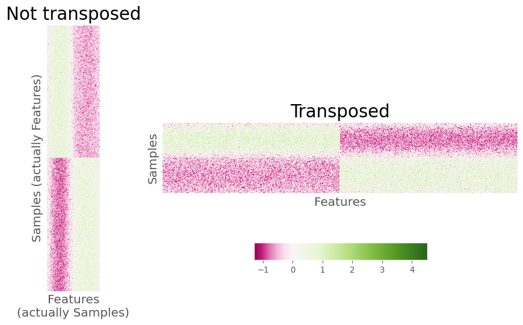
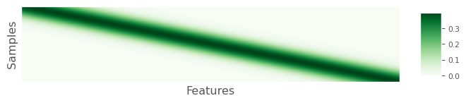
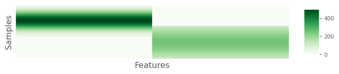
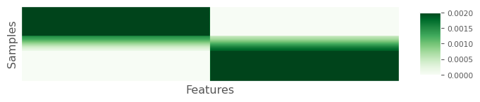
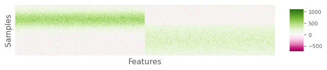
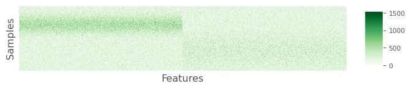
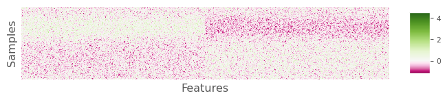

# THINK ABOUT TENSE OF VERBS!

The code chunks displayed below are copied directly from the code used
by Martino et al. (“Martino”) and the line numbers correspond to the
indicated files. The hyperlinks in the text go to the GitHub repository
for the [current
project](https://github.com/SchlossLab/Schloss_RPCA_XXXXXX_2024), which
is a copy of the [original
repository](https://github.com/cameronmartino/deicode-benchmarking)
developed by Martino. Martino’s repository was [forked from the Deicode
repository](https://github.com/biocore/DEICODE/commit/ea7835b9a0d16c35685542a81d05ee12c412c6ba)
January 28, 2019. The only changes between the Martino repository and
the copy for this project was to make the directory and file names
lowercase and to replace hyphens with underscores.

# Review of code used to generate positive and negative control heatmaps in Figure 3DE of Martino

Review of the code in
[`deicode_benchmarking/simulations/negative_control.ipynb`](https://github.com/SchlossLab/Schloss_RPCA_XXXXXX_2024/blob/main/deicode_benchmarking/simulations/negative_control.ipynb)
reveals two important problems with the generation Martino’s Figure 3DE.
For background, the `X_random` and `X_signal` matrices represented the
negative and positive controls, respectively, that were generated in an
earlier block of this notebook. For both matrices, there were 1000 rows
for each feature or taxon and 200 columns for each sample. At L13 and
L15 of block 183, the [`imshow`
function](https://matplotlib.org/stable/api/_as_gen/matplotlib.pyplot.imshow.html)
from the pyplot package within the `matplotlib` Python library is used
to generate heatmaps of the two matrices.

``` python
#show the results
fig,((ax1,ax2),(ax3,ax4)) = plt.subplots(2,2,figsize=(12,8))

ax1.imshow(clr(X_signal+1),aspect='auto',norm=MidpointNormalize(midpoint=0.), cmap='PiYG')
ax1.set_title('Positive Control Simulation',fontsize=22)
cbim = ax2.imshow(clr(X_random+1),aspect='auto',norm=MidpointNormalize(midpoint=0.), cmap='PiYG')
ax2.set_title('Negative Control Simulation',fontsize=22)
```

Within the arguments to `imshow`, the matrices are transformed by adding
1 to each cell and then subjecting the matrices to a central log ratio
transformation with the [`clr`
function](https://scikit.bio/docs/dev/generated/skbio.stats.composition.clr.html#skbio.stats.composition.clr)
from the composition statistics module of the `skbio` Python library. It
is important to note that the `clr` function assumes that the rows
represent compositions or samples and the columns represent the
components or taxa. Therefore, `X_random` and `X_signal` should have
been transposed prior to performing the clr transformation. For example,
earlier at L2 and L6 of the same code block, the matrices were
transposed prior to using the `rclr` function.

``` python
#RPCA on random
X_random_rclr = rclr().fit_transform(X_random.T)
opt_noise = OptSpace().fit(X_random_rclr)
U_random = pd.DataFrame(opt_noise.sample_weights,index=X_random.columns)
#RPCA on very clear signal
X_signal_rclr = rclr().fit_transform(X_signal.T)
opt_sig = OptSpace().fit(X_signal_rclr)
U_signal = pd.DataFrame(opt_sig.sample_weights,index=X_signal.columns)
```

As executed in the notebook, the result of using the `clr` function was
the same shape as the input matrices with features as rows and samples
as columns. The transformed data were then used in the `imshow` function
which plots the rows and columns of the matrix to the rows and columns
of the heatmap. However, later at L21-24 in the same code block,
“Samples” is added to the y-axis label and “Features” is added to the
x-axis label, which is the reverse of the actual situation. These
problems hid the fact that samples rather than taxa were shared between
the treatment groups. Of course, sharing samples between treatment
groups does not make sense and the taxa instead should have been shared.

``` python
ax2.set_ylabel('Samples',fontsize=15)
ax1.set_ylabel('Samples',fontsize=15)
ax2.set_xlabel('Features',fontsize=15)
ax1.set_xlabel('Features',fontsize=15)
```

The problem with the labelling of the axes can more clearly be seen by
changing the value of the `aspect` argument in `imshow` from `'auto'` to
`None` on L13-14. To summarize, the code in this block (i) performed the
CLR transformation across the samples rather than across the taxa and
(ii) mislabelled the axes of the heatmaps in Martino’s Figure 3DE. Both
problems could have been avoided by transposing the matrices within the
arguments to `clr` at L13 and L15. The result is shown below on the
right.



# Review of `build_block_model` function and its dependencies

Because it was clear that there was a problem in the simulation code
such that samples rather than taxa were shared between treatment groups,
I reviewed the code in
[`build_block_model`](https://github.com/SchlossLab/Schloss_RPCA_XXXXXX_2024/blob/main/deicode_benchmarking/simulations/scripts/simulations.py#L175)
and related functions to better diagnose the problems in the simulation.
The `build_block_model` function can be found in
[`deicode_benchmarking/simulations/scripts/simulations.py`](https://github.com/SchlossLab/Schloss_RPCA_XXXXXX_2024/blob/main/deicode_benchmarking/simulations/scripts/simulations.py).
The function is called in
`deicode_benchmarking/simulations/negative_control.ipynb` to generate
the positive control data in Figure 3D and in
`deicode_benchmarking/simulations/scripts/cluster_build.py` to generate
the overlapping data analyzed in Martino’s Figure 3ABC. The
`build_block_model` function is listed below except for lines
corresponding to comments (L185-236) and code that did not impact the
generation of `X_noise` (L244-253 and L262-267). The function returned
the values of `X_true` and `X_noise`.

``` python
def build_block_model(
        rank,
        hoced,
        hsced,
        spar,
        C_,
        num_samples,
        num_features,
        overlap=0,
        mapping_on=True):
```

``` python
    X_true = block_diagonal_gaus(
      num_samples,
      num_features,
      rank,
      overlap,
      minval=.01,
      maxval=C_)
```

``` python
    X_noise = X_true.copy()
    X_noise = np.array(X_noise)
    # add Homoscedastic noise
    X_noise = Homoscedastic(X_noise, hoced)
    # add Heteroscedastic noise
    X_noise = Heteroscedastic(X_noise, hsced)
    # Induce low-density into the matrix
    X_noise = Subsample(X_noise, spar, num_samples)
```

As called in `cluster_build.py`, the value of `rank` was 2 (i.e., the
number of treatment groups), `num_samples` was 200 (i.e., the number of
samples across all treatment groups), `num_features` was 1000 (i.e.,
number of taxa or features), and `overlap` was 20 (i.e., the number of
features that overlapped between the treatment groups; it was zero in
the positive control analysis). The values of `spar`, `C_`, `hoced`, and
`hsced`, were based on a parameter that was altered for each sequencing
depth. The `spar` and `C_` values were set to the same value (e.g.,
2500) and were used to scale the relative abundance values in the
`Subsample` (L261) and `block_diagonal_gaus` (L237-243) functions,
respectively. As used in the simulations with partially overlapping
features the `hoced` and `hsced` values were set to `hoced` and `hsced`
values divided by 15; for the positive control analysis they were
divided by 60. These values were used in the `Homoscedastic` (L257) and
`Heteroscedastic` (L259) functions where `hoced` and `hsced` were used
to set the standard deviation of a normal distribution with mean set to
the relative abundance of the sample-taxon pair receiving additional
noise uniformly or randomly. The values of `spar`, `C_`, `hoced`, and
`hsced` that were used in `build_block_model` were selected by fitting
the model to experimental data from a study comparing the microbial
communities on subject’s fingers and keyboards. Although I did not
attempt to replicate their model fitting, other code is found in
`simulations.py` that ostensibly performs this analysis.

A general problem with the code in `simulations.py` was that if I loaded
`simulations.py` and ran `build_block_model` multiple times with the
same input data and random number generator seed, the code did not
produce the same results. Although not a critical problem, the lack of
computational reproducibility was part of my motivation to assess the
benchmarking test results with ten rather than only one seed.

Finally, comments in `build_block_model` describe the function as
returning a data frame with `num_samples` rows and `num_features`
columns (L227-227). In fact, it returns a data frame with `num_features`
rows and `num_samples` columns. This confusion might help explain why
samples rather than features overlap in the `block_diagonal_gaus`
function as written. This issue is described in the next section.

``` python
    Returns
    -------
    Pandas Dataframes
    Table with a block diagonal where the rows represent samples
    and the columns represent features.  The values within the blocks
    are gaussian.
```

## Review of `block_diagonal_gaus` function

The function
[`block_diagonal_gaus`](https://github.com/SchlossLab/Schloss_RPCA_XXXXXX_2024/blob/main/deicode_benchmarking/simulations/scripts/simulations.py#73)
creates a model that describes the abundance of each taxon across the
samples for each treatment group before any noise has been applied to
the data. This function is called by `build_block_model` and is also
found in
[`deicode_benchmarking/simulations/scripts/simulations.py`](https://github.com/SchlossLab/Schloss_RPCA_XXXXXX_2024/blob/main/deicode_benchmarking/simulations/scripts/simulations.py).

``` python
def block_diagonal_gaus(
        ncols,
        nrows,
        nblocks,
        overlap=0,
        minval=0,
        maxval=1.0):
```

As used in Martino, `ncols` was 200 and `nrows` was 1000. As described
in the Methods of the original study, the model uses a normal
distribution to vary the relative abundance of each taxa with different
distributions for each treatment group such that a specified fraction of
taxa overlapped between the two treatment groups. Within
`block_diagonal_gaus` the number of treatment groups was specified with
`nblocks`, which was 2 and the overlap was specified with `overlap`,
which was 20 for the partial overlap simulation and 0 for the positive
control simulation. The value of `maxval` was used to scale relative
abundance values in the function and was set to the parameter described
in the previous section (e.g., 2500 for a sequence depth of 4000). The
function generates a matrix with `ncols` samples and `nrows` taxa;
however, comments in the function describe a transposed version of the
matrix. In addition, as I’ll show below, the output is not a block
diagonal.

``` python
    Returns
    -------
    np.array
        Table with a block diagonal where the rows represent samples
        and the columns represent features.  The values within the blocks
        are gaussian distributed between 0 and 1.
```

``` python
    if nblocks <= 1:
        raise ValueError('`nblocks` needs to be greater than 1.')
    mat = np.zeros((nrows, ncols))
    gradient = np.linspace(0, 10, nrows)
    mu = np.linspace(0, 10, ncols)
    sigma = 1
    xs = [norm.pdf(gradient, loc=mu[i], scale=sigma)
          for i in range(len(mu))]
    mat = np.vstack(xs).T
```

The function begins by initializing a matrix with zeroes (i.e., `mat`)
and a graidient of values to define a distribution (i.e., `gradient`).
However, this code is largely superfluous since the values of these
values are written over by subsequent code before the matrix (i.e.,
`mat`) is updated. Regardless, operationally, `mat` is defined as a
matrix of zeroes with `num_features` rows and `num_samples` columns
(L188). A vector with `num_features` values, `gradient`, is defined as a
linear interpolation between the values of 0 and 10 (L189). Similarly, a
vector with `num_samples` values, `mu`, is defined as a linear
interpolation between the values of 0 and 10 (L190). These values along
with a `sigma` value of 1 are used to create a `num_samples` long vector
of arrays, which are each `num_features` long (L123-124). This vector of
arrays, `xs`, takes its values from the Normal probability density
function at the `num_features` values of `gradient` under a distribution
with a mean at each of the `num_samples` values of `mu` with a standard
deviation of `sigma` (i.e., 1). The `num_features` by `num_samples`
matrix `mat` is generated by combining each element of `xs` as the
columns. As suggested in the comment above from L108-110, this matrix
has maximum probabilities along the diagonal of the matrix. Values far
off the diagonal are nearly zero. For example, the value for the first
feature in the first sample was 0.3989 and it was 7.7e-23 in the last
sample. The following is a heatmap visualization of the raw values in
the matrix (the matrix has been transposed).



As stated above in my description of L117-125, the values of `mat` are
largely overwritten by the following lines of code.

``` python
    block_cols = ncols // nblocks
    block_rows = nrows // nblocks
    for b in range(nblocks - 1):

      gradient = np.linspace(5, 5, block_rows)  # samples (bock_rows)
      # features (block_cols+overlap)
      mu = np.linspace(0, 10, block_cols + overlap)
      sigma = 2.0
      xs = [norm.pdf(gradient, loc=mu[i], scale=sigma)
            for i in range(len(mu))]

      B = np.vstack(xs).T * maxval
              lower_row = block_rows * b
              upper_row = min(block_rows * (b + 1), nrows)
              lower_col = block_cols * b
              upper_col = min(block_cols * (b + 1), ncols)

              if b == 0:
                  mat[lower_row:upper_row, lower_col:int(upper_col + overlap)] = B
              else:
                  ov_tmp = int(overlap / 2)
                  if (B.shape) == (mat[lower_row:upper_row,
```

L127 and L128 define the number of columns (`block_cols`) and rows
(`block_rows`) in each block. Because `nblocks` is 2 for all
simulations, these values become 100 and 500, respectively. At L129, a
loop is initiated for values of the index variable `b`, which ranges
between 0 and the integer less than `nblocks-1` or 0. Therefore, the
loop is only executed once and the else statement at L146-159 is never
executed. At L131 and L133 new versions of `gradient` and `mu` are
generated. All of the values in `gradient` are 5 and the values in `mu`
are taken from a linear extrapolation between 0 and 10. **This is
evidence that Martino’s simulation considered the overlap of samples
rather than features.** The vector `mu` has `block_cols` (i.e., 100)
plus `overlap` (i.e., 20) values. Because the columns contain sample
data the additional 20 columns represent 20 additional samples rather
than features. The code that was described at L123-125 is repeated as
L135-138, using a standard deviation of 2 rather than 1. The resulting
matrix, `B`, has 500 rows and 120 columns. Each row of `B` is identical
with the columns being the value of the probability distribution
function at 5.0 (i.e., `gradient` as defined at L131) for a normal
distribution with the 120 values of `mu` as the mean and 2.0 (i.e.,
`sigma`) as the standard deviation. At L145, this matrix is used to
replace the values in the upper left quadrant of `mat` in L139-145. The
values of the first 500 rows in the last 80 columns are all nearly zero
and are taken from the value of `mat` generated at L125.

``` python
    upper_col = int(upper_col - overlap)
    # Make last block fill in the remainder
    gradient = np.linspace(5, 5, nrows - upper_row)
    mu = np.linspace(0, 10, ncols - upper_col)
    sigma = 4
    xs = [norm.pdf(gradient, loc=mu[i], scale=sigma)
          for i in range(len(mu))]
    B = np.vstack(xs).T * maxval

    mat[upper_row:, upper_col:] = B
```

The code shown here is very similar to what was done at L131-138. The
only difference was that in this chunk they used a standard deviation of
4.0 (i.e., `sigma`) instead of 2.0. The new value of `B` defined at L168
was used to complete the value of `mat` by filling in the last 500 rows
and the last 120 columns (L170). Again, the values of the first 80
columns in the last 500 rows were nearly zero.

In conclusion there were three issues with the code in the
`block_diagonal_gaus` function. First, the code at the beginning of the
function (L117-125) was extraneous. Second, and more important, the
features had the same relative abundance within each sample. Finally,
and perhaps most important, samples were shared across features rather
than features being shared across samples. As written in the original
Jupyter notebook, the at the end of the `block_diagonal_gaus` function,
using values of `ncols` set to 200, `nrows` to 1000, `nblocks` to 2,
`overlap` to 20, and `maxval` to 2500 resulted in a 1000 row by 200
column matrix. This is a heatmap depiction of the raw values in `mat`
with lighter colors are lower abundance while darker colors are higher
abundance.



To highlight the observation that the probabilities were the same for
each feature across non-overlapping samples within the same block, the
following heatmap shows the relative abundances of each feature:



## Review of `Homoscedastic`

The `Homoscedastic` function applies noise randomly sampled from a
normal distribution to each sample-taxon pair of the matrix using the
abundance of the sample-taxon pair as the mean and `intensity` as the
standard deviation. For the cases where overlap was included between the
treatment groups, the intensity was the model parameter (e.g., 2500)
divided by 15 (i.e., 166.6667) and for the case where there was no
overlap between the treatment groups, the intensity was the model
parameter divided by 60 (i.e., 41.6667).

``` python
def Homoscedastic(X_noise, intensity):
    """ uniform normally dist. noise """
    X_noise = np.array(X_noise)
    err = intensity * np.ones_like(X_noise.copy())
    X_noise = rand.normal(X_noise.copy(), err)

    return X_noise
```

The code from L42-48 shows a potential problem. The median abundance in
`X_noise` coming into `Homoscedastic` across all samples was 115.7 with
a maximum value of 498.6 (see the two previous heatmaps). Considering
that random numbers were drawn from distributions with a standard
deviation of 166.67 it was likely that negative values would result. In
fact, for this example, 28.5% of the sample-taxon pairs were negative.
It is likely that the normal distribution should have been truncated by
turning negative values to zeroes. Below is a heatmap depiction of
`X_noise` after running the `Homoscedastic` function on L257 of the
`build_block_model` function in `simulations.py`.



## Review of `Heteroscedastic`

Similar to `Homoscedastic`, the `Heteroscedastic` function applies noise
randomly sampled from a normal distribution using the abundance of the
sample-taxon pair from `X_noise` as the mean and `intensity` as the
standard deviation. Again, for the simulations of the partially
overlapping features between treatment groups, the intensity was the
model parameter (e.g., 2500) divided by 15 (i.e., 166.6667) and for the
case where there was no overlap between the treatment groups, the
intensity was the model parameter divided by 60 (i.e., 41.6667). The
primary difference from `Homoscedastic` is that `Heteroscedastic`. The
“Simulations” subsection of the “Materials and Methods” section of
Martino indicated that the heteroscedastic source of noise was only
supposed to be applied to a random subset of the sample-taxon pairs.
However, review of the code for the `Heteroscedastic` function shows
that it applied the noise to all values of `X_noise` rather than to a
subset.

``` python
def Heteroscedastic(X_noise, intensity):
    """ non-uniform normally dist. noise """
    err = intensity * np.ones_like(X_noise)
    i = rand.randint(0, err.shape[0], 5000)
    j = rand.randint(0, err.shape[1], 5000)
    err[i, j] = intensity
    X_noise = abs(rand.normal(X_noise, err))

    return X_noise
```

At L53 the code generates `err`, which is a matrix with the same
dimensions as `X_noise` where every cell has the value of the intensity
(e.g.,166.67). On L54-55 they select 5000 random row and column indices
that are then used in L56 to assign values of `err` to `intensity`.
Except, L54-56 do not change the existing values of `err` since the
values in the matrix were all already set to the value of `intensity` at
L53. At L57, noise is added to all values of `X_noise` much like was
done in `Homoscedastic` at L46. It is likely that the authors intended
to use the numpy `zeros_like` function on L53 instead of the `ones_like`
function. Then at L56, `err` would have had 5000 cells with the value of
`intensity` and the `rand.normal` function would have changed only those
values at L57. One notable difference to `Homoscedastic` is that L57
uses `abs` to return the absolute value of `rand.normal`. Prior to
applying the absolute value to the abundances with the additional noise,
32.2% of the sample-taxon pairs were negative. Using `abs` would
certainly add noise to a subset of `X_noise`, but it would not be random
since it would disproportionately impact low abundance features. As
mentioned for `Homoscedastic` returning zero rather than negative values
or their absolute value would likely have been preferred. Below is a
heatmap depiction of `X_noise` after running the `Heteroscedastic`
function on L259 of the `build_block_model` function in
`simulations.py`.



## Review of `Subsample`

In the final step of `simulations.py`, the values of `X_noise` are used
to generate a count matrix with the desired number of individuals per
sample (L261) using the `Subsample` function.

``` python
def Subsample(X_noise, spar, num_samples):
    """ yij ~ PLN( lambda_{ij}, /phi ) """
    # subsample
    mu = spar * closure(X_noise.T).T
    X_noise = np.vstack([poisson(lognormal(np.log(mu[:, i]), 1))
                         for i in range(num_samples)]).T
    # add sparsity

    return X_noise
```

This function takes `X_noise` as input along with the `spar` and
`num_samples` parameters. The value of `spar` is the same model
parameter value that was used to scale the relative abundances in
`block_diagonal_gaus` (e.g., 2500). At L54, the relative abundance of
features within each sample was determined and then multiplied by `spar`
to generate `mu` which was a `num_features` by `num_samples` array.
These values were used to generate counts for each sample-taxon pair
using a Poisson-lognormal distribution, which produces a new version of
`X_noise`, which was returned to `build_block_model` and used for the
rest of the analysis.

Below is a heatmap depiction of the central log ratio transformation of
`X_noise` after adding 1 to each cell at the end of the
`build_block_model` function in `simulations.py`.



The matrix generated from `Subsample` did not have a consistent total
number of counts for each sample. When using the model parameter of
2500, values near 4000 individuals per sample were obtained, but there
was considerable variation. Using the model parameter value of 2500, the
mean number of individuals per sample was 4099.4 with a range between
3539 and 4598. Considering the claim that RPCA is invariant to
differences in sampling effort, it would be desirable to control whether
samples had the same number of individuals. As a workaround for this
problem, I increased the model parameter (e.g., 2800) so that the
minimum sample size was greater than the desired number of individuals
and then down sampled each sample to the desired number.

## Summary

Five problems were found in the code as written in the original
`simulations.py` script. They are listed here in order of importance.

**1. Samples, not features, were shared between the two treatment
groups.** The intention was that features should be shared between
treatment groups, not samples.  
**2. Among samples from the same treatment group, the abundance
distributions for each feature were uniform.** The result was that the
relative abundance for all features in the same sample and treatment
group had the same expected relative abundance. The intention was likely
that the abundance distribution within each sample varied by feature.  
**3. The total number of individuals varied across each sample.**
Although there were claims that RPCA was insensitive to uneven sampling
effort, this was not actually demonstrated in Martino. It was necessary
for me to make the sampling effort uniform so this could be tested **4.
The heteroscedastic source of noise was actually applied to all
sample-taxon pairs.** The result was a second addition of noise to all
sample-taxon values rather than the intended subset of values.  
**5. Negative mean values were used as the mean in normal distribution
sampling functions when calculating the heteroscedastic noise.** It is
likely that the intention was for negative values to be transformed to
zeros before sampling the distribution.  
**6. The signs of negative values generated after applying the
heteroscedastic noise were made positive.** It is likely that the
intention was for negative values to be transformed to zeros.  
**7. Setting the random number generator seed was inadequate to ensure
that rerunning `simulations.py` with the same parameters yielded the
same result.**

I suspect that the confusion over the information contained in the rows
and columns of the positive and negative controls was principly caused
by the first two problems listed in this summary. Taken together, these
problems do not entirely invalidate the claims made by Martino about the
performance of RPCA. Regardless, it was necessary to re-evaluate the
claims with revised code.Therefore, I rewrote `simulations.py` as an R
script `simulations.R` (found in `workflow/scripts/`) that resolved the
above-mentioned problems.

# Review of simulation analysis code

Continuing my review of the code used in the published benchmarking
analysis, I next inspected the code that was used to calculate the
PERMANOVA F statistics and P-values and k-Nearest Neighbor (KNN)
accuracy values. Review of the code in
`deicode_benchmarking/simulations/negative_control.ipynb` and
`deicode_benchmarking/simulations/scripts/cluster_build.py` and the data
outputted to
`deicode_benchmarking/simulations/cluster_models/simulation_subsampled_noisy.csv.gz`
made it clear that each simulation (i.e., negative, positive, and
overlapping) were only replicated a single time making it impossible to
assess the sensitivity of the simulation results on the choice of the
random number generator seed.

Aside from the lack of simulation replication, my primary critique was
the KNN analysis. The manuscript stated “ordination output was compared
by permutational multivariate analysis of variance (PERMANOVA)
F-statistic and supervised k-nearest neighbor (KNN) classification
cross-validation (40:60) split”. The convention for describing
cross-validation splits is to indicate the percentage of samples used in
the training set followed by the percentage used in the testing set.
Therefore, according to a 40:60 split, 40% of the samples would have
been used to train the model and 60% would have been used to test the
model. Such a split would be curious since the training set is typically
larger than the testing set. Furthermore, a split is typically performed
multiple times to remove bias from the selection of the random number
generator seed.

Analysis of the benchmarking code made it clear that a 40:60 split was
not used. In fact, for the negative and positive control analyses
reportedin their Table S1, the authros used an 80:20 training-testing
splits. This can be seen on L7 of box 186 from
`deicode_benchmarking/simulations/negative_control.ipynb` shown here:

``` python
pcoa_tmp = pcoa(DistanceMatrix(distance.cdist(U_,U_))).samples
pcoa_tmp.index = T_.T.index
# split
X_train, X_test, y_train, y_test = train_test_split(pcoa_tmp, meta['group'].ravel(), 
                                                    test_size=.2, 
                                                    stratify=meta['group'].ravel(), 
                                                    random_state=42)
knn = KNeighborsClassifier(n_neighbors=10).fit(X_train, y_train)
```

In contrast, they used 60:40 training-testing splits to analyze the data
simulated with overlapping features. This can be seen on L75 of
`deicode_benchmarking/simulations/scripts/cluster_results.py` as shown
here:

``` python
pcoa_tmp=pcoa(DistanceMatrix(distance.cdist(U_tmp,U_tmp))).samples
pcoa_tmp.index=subtmp_sub.index
# split
X_train, X_test, y_train, y_test = train_test_split(pcoa_tmp, meta['group'].ravel(), 
                                                    test_size=.4, 
                                                    stratify=meta['group'].ravel(), 
                                                    random_state=42)
knn = KNeighborsClassifier(n_neighbors=13).fit(X_train, y_train)
```

Review of the code in both `negative_control.ipynb` and
`cluster_results.py` made it clear that only a single split of the data
was performed.

Finally, the choice of the number of neighbors (i.e., k) to use in the
KNN analysis was not described in the manuscript. Often the training set
will be repeatedly split to fit such hyperparameters \[**XXXXXX**\]. As
shown above in the code from box 186 `negative_control.ipynb` at L10, a
k value of 10 was used for classifying the positive and negative control
data. In contrast, as shown above in the code from `cluster_results.py`
at L78, a k value of 13 was selected for classifying the samples with
overlapping features.

In summary, the authors used inconsisitent splits and k-values in their
simulations, misstated the nature of the split, did not incorporate
multiple splits, and provided no information for how the k-value was
selected. These problems raise the question of whether their models were
overfit (i.e., too small of a k value) or underfit (i.e., too large of a
k value). I implemented my own version of a KNN classifier
(`workflow/scripts/test_train_knn.R`) that allows users to input a
distance matrix, training, validation, and testing fractions, and the
number of iterations.

# Review of case study analysis code

- when using RPCA all of the sequences in each sample were used but only
  1,000 sequences per sample were used with the Bray-Curtis and weighted
  UniFrac distances (**Supplementary Text**).

- Performed 1 60:40 split (said 10-fold, but repeated the same split 10
  times)

- They did not fit hyperparameter: choice for k in case studies was
  messed up, in some cases using a fraction of the number of columns in
  the metadata file

- Used raw and rclr transformed data as input to matrix completion
  followed by PCA. The output from PCA was used as input to kNN. Later,
  they used weighted UniFrac and Bray-Curtis ordinations to generate
  distances - would have preferred to use the distances themselves as
  input
